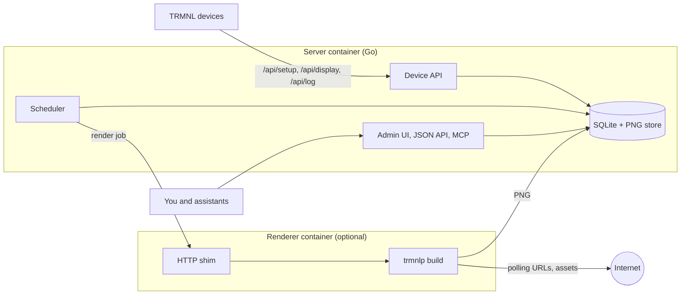

# TRMNL BYOS Server in Go: Design

## Summary

We will build a small Go + SQLite server that speaks the TRMNL device protocol, pre-renders every screen before the device wakes, and renders TRMNL recipes unmodified by driving trmnlp in an optional sidecar container. The first deployment is two 7.5" OG DIY kits on a Proxmox container, but nothing is hardcoded to that panel.

**Goals**

- Support every model in TRMNL's registry: 1-bit, 4-gray, 16-gray and the limited color palettes, at any size and scale factor.
- Run TRMNL recipes (settings.yml + Liquid + transforms) with the same output as TRMNL's own renderer.
- Keep the device awake as briefly as possible: one fast request per wake, no download or repaint when nothing changed.
- Small, boring operations: one static Go binary, one SQLite file, no database or queue server.
- Easy for an AI assistant to extend: recipes as the plugin format, an MCP server for authoring and previews.
- Safe firmware updates: never send a build to a board it was not built for.

**Non-goals for v1**

- Multi-user accounts. One admin, or auth delegated to a reverse proxy.
- A drag-and-drop screen designer.
- Proxying to the TRMNL cloud, OAuth plugins, and native (non-browser) rendering. These are designed for and deferred (see [Deferred work](#deferred-work)).

## Alternatives considered

No existing server combines faithful recipe rendering with a small footprint, so we build one and borrow their best ideas.

| Option | Stack | Why not | What we borrow |
| --- | --- | --- | --- |
| Terminus | Ruby/Hanami, Postgres, Valkey, Sidekiq, Chromium (4 containers) | Heaviest stack. Own Liquid with 15 of ~25 TRMNL filters, always uses the latest framework, no transforms. Playlist cursor is shared across devices and advances on every wake. | Per-device button command, sleep windows, extension refresh schedules, detailed device logs, model and firmware sync jobs |
| byos_next | Next.js, Postgres, optional Chrome | Last commit Jun 30. Own Satori-based screens looked weak. | Little |
| Inker | NestJS, SQLite, Chromium | Moving to an Inker-native ecosystem. Imitation TRMNL CSS (~300 lines). Sends 8-bit gray PNGs, so the OG shows black and white only. | Per-item durations with drift-free timing, clock-aligned wakes, shared data sources, encrypted plugin secrets, device blocklist, live UI events |
| LaraPaper | PHP/Laravel, SQLite, Chromium | PHP. Approximate Liquid by default, no transforms, user Blade templates run as PHP. | MCP server, time-limited join window, scheduled playlists, alias endpoint, staleness flags, cloud proxy (deferred) |
| Ogre (pure-Go HTML to PNG) | Go library | Bugs in basics (borders, SVG strokes, truncation, min-width), one maintainer, 13 outside PRs unreviewed. Cannot run the framework's JavaScript, so it can never render recipes. | Kept as a possible native renderer later |

**Why trmnlp.** trmnlp is TRMNL's own plugin development tool (MIT). It uses the official `trmnl-liquid` gem, the real page wrapper with pinned framework versions, runs transforms in Python, JS, Ruby and PHP, and copies TRMNL's quantization per palette. It is the closest open reference to how the cloud renders a recipe.

## Architecture

A Go server owns all state and answers devices from cached PNGs; an optional trmnlp container does the rendering, fed through shared volumes.

Device requests never wait on a render: the scheduler renders ahead, the shim runs one `trmnlp build` per job, and the PNG lands in the store by content hash.

- **Server**: device API, scheduler, store, admin UI, JSON API, MCP server and webhook ingest in one binary.
- **Renderer**: the `trmnl/trmnlp` image plus a small HTTP shim. It sees only the `projects` volume, never the database or secrets. It sits on an internal network with no route out; its only way to the internet is the server's filtering proxy (see Security and privacy).
- **Asset cache**: the renderer's proxy caches the framework's CSS, JavaScript, fonts and images, Highcharts, and Google Fonts on the server's disk, so each is fetched from the internet once, and recipes pinned to old framework versions keep rendering.

## Device protocol and profiles

The server implements the three endpoints TRMNL firmware calls, and never renders inside a device request.

| Endpoint | Request | Response |
| --- | --- | --- |
| `GET /api/setup` | `ID` (MAC), `Model`, `FW-Version`, `Width`, `Height` | A new `api_key`, `friendly_id`, and an empty `image_url`, so the firmware draws its own screen with the friendly ID. Accepted only while the join window is open. |
| `GET /api/display` | `Access-Token`, battery, RSSI, `Refresh-Rate`, `Update-Source`, `special_function`, `Wake-Time`, `Image-Cached`, `SENSORS`, `Width`/`Height` | `image_url`, `filename`, `refresh_rate` (a number), `special_function`, `update_firmware`/`firmware_url`, `reset_firmware`, `temperature_profile`, `maximum_compatibility` |
| `POST /api/log` | Firmware log entries | Stored per device with wake reason, heap and Wi-Fi state |

**Status codes.** The firmware reads the JSON `status` field, not the HTTP status, so `/api/setup` and `/api/display` answer HTTP 200 with the outcome in the body.

- `/api/setup` sends 200 for a registered device. For an unknown MAC it sends 404 with an `image_url`, which the device shows before trying again every 5 minutes.
- `/api/display` sends 0 for a normal response. The firmware ignores a response whose status is 200.
- An unknown device or a wrong token gets 202. The device keeps its credentials, shows its own setup screen, and polls again soon.
- Status 500 and `reset_firmware: true` both make the device erase its key, friendly ID, Wi-Fi settings and server URL, then start its setup portal. No response clears only the key. The server never sends 500. It sends `reset_firmware` to a deleted device, and to a registered MAC presenting a key that a later setup replaced. That device would otherwise keep its old key, never run setup again, and sit on its setup screen.
- An unknown MAC, or a request with no `ID`, is never reset. It may mean the server lost its database or is reading the wrong data directory, and a reset then would wipe every display at once.

**Device profile.** Each device resolves to a profile: width, height, rotation, offsets, scale factor, palette, plus the framework's CSS parameters (CSS screen size, pixel ratio, dither pixel ratio, density class). Resolution order:

1. Per-device override set in the UI.
2. The firmware `Model` header mapped to a registry model. Firmware names differ from registry names (`xiao_epaper_display` and `og` map to `og_plus`; `x` maps to `v2`), so we keep a small mapping table.
3. `Width`/`Height` headers matched against the registry.
4. A conservative default (800x480, 1-bit).

The registry is a vendored copy of `trmnl.com/api/models` and `/api/palettes`, refreshed daily, never fetched per request.

**Gray calibration.** The registry's gray palettes assume evenly spaced levels, and no measured brightness for any panel's levels has turned up. `trmnl-byos calibrate` shows a device a screen where each middle gray sits over black-and-white ordered dither patches with 1 to 15 of every 16 pixels black. The patch that matches from arm's length measures the level to about 1/16. `-dot 2` draws the dither with 2x2-pixel dots, to check whether the panel blurs isolated single pixels and skews the result.

The OG DIY kit measured 2/16 and 6/16 of white's light for its dark and light grays. Evenly spaced light would be 0.33 and 0.67, so the panel's grays are not evenly spaced in light. They are within measurement error of evenly spaced sRGB values (`#555555` and `#aaaaaa` give off 0.09 and 0.40), so TRMNL's palette is right if read as sRGB.

The server draws its own screens as ink coverage and maps each pixel to the level whose measured light is nearest the light the pixel should give off. Measured levels are kept per firmware model; a model not yet measured is assumed to be evenly spaced in sRGB. For the OG this puts glyph edges with 94% coverage or more at black, 75 to 94% at dark gray, 31 to 75% at light gray, and less at white. Blending in sRGB values and rounding, as before, made edges darker and text bolder than the font. Recipes are quantized by trmnlp and are not affected.

**Non-TRMNL clients.** KOReader, Kindle, Kobo, Nook, Android and Raspberry Pi clients speak the same `/api/display`. They may omit firmware headers such as `Update-Source` or the battery fields, so every header is optional.

**Joining and leaving.**

- A time-limited join window (default 10 minutes) admits devices; otherwise setup gets a "not registered" response. Until the admin UI exists, `trmnl-byos join` opens it.
- A known MAC needs the window too, since anything on the LAN can see a MAC. A device that lost its credentials re-pairs while the window is open and keeps its friendly ID and settings. Each setup issues a new key and retires the old one.
- A MAC blocklist rejects specific devices outright.
- Deleting a device makes its next request return `reset_firmware: true`, so it forgets its credentials. It also forgets its Wi-Fi settings and server URL and needs the setup portal again. Delete keeps the device's MAC as a tombstone until then, since an unknown MAC is never reset.

## Scheduling and pre-rendering

Every screen a device might ask for is rendered before it wakes, and an unchanged screen costs the device one short request and no repaint.

**What the firmware gives us.** If `filename` matches a file in its flash cache, the firmware skips the download. If that image is already on the panel, it also skips the repaint (`displayed_image.h`). It reports the previous wake's duration in `Wake-Time`, which the dashboard plots.

**Rules.**

1. `filename` is the first 16 hex digits of the PNG's SHA-256. Same pixels, same name. The firmware keeps at most 31 characters of a filename as-is.
2. `/api/display` is a SQLite lookup plus a static file. If nothing is ready (new device, cold start) it returns the last image, or a placeholder with a short `refresh_rate`.
3. `refresh_rate` is chosen from content, not fixed: the seconds until the current playlist item ends, the next aligned wake a plugin asked for (on the minute, on the hour), or the next sleep-window edge, whichever comes first.
4. Next wake = last request + the `refresh_rate` we sent. Renders are scheduled ahead of it with a lead time that covers render duration (seconds for trmnlp) plus deep-sleep clock drift.
5. Each device always has three screens ready: current (for button and power-on wakes), next (for skip and touch-bar next) and a short history (for rewind).

**Renders follow data, not wakes.** A plugin instance re-renders only when its `refresh_interval` comes due or its data changes. Wakes in between get the same filename. This matters because 8 of the top 25 recipes print the time or use randomness, so their output differs on every render.

**Render cache key.** (plugin instance, layout, device profile) by default. (plugin instance, layout, device) when the recipe references `trmnl.device.friendly_id` or battery fields. Two OGs showing the same weather share one render.

**Staleness.** Each instance records its last successful fetch. Past a configurable age the item is skipped in rotation, or shows a stale marker, instead of silently showing old data.

## Playlists, mashups and input

Rotation is time-based and tracked per device: each item shows for its own duration, and two devices on one playlist never steal each other's turns.

**Model.**

- A device has one or more playlists. Each playlist has an optional schedule: weekdays plus an active time window. The first active playlist in priority order wins; otherwise a default.
- A playlist item is either one plugin instance at full layout, or a mashup: a layout (left/right, top/bottom, quadrants) with a plugin instance per slot.
- Each item has a duration, or none. An item with no duration stays until a button or touch-bar press, with a long `refresh_rate`.
- Items can carry their own schedule (days, time window, date range) and a hidden flag.

**Cursor.** Stored per device as (current item, started at). When a wake finds the duration elapsed, the cursor moves to the next eligible item and the new start time is the old start plus the duration, so timing does not drift. A changed playlist sets a pending flag that resets the cursor on the next wake.

**Input.** The headers say what woke the device; we never guess from timing.

| Signal | Source | Action |
| --- | --- | --- |
| `Update-Source: timer` | Scheduled wake | Advance if the item's duration elapsed |
| `Update-Source: button`, `EXT0` or `EXT1` | Single press. The value is the ESP32 wake source, so it depends on the board: the OG DIY kit sends `EXT0`. | The device's configured command: next (default), previous, first, or refresh |
| `special_function` header | Double click, or the TRMNL X touch bar | `rewind` shows the previous screen from history, `restart_playlist` jumps to the first item; others as configured |
| Touch bar right | TRMNL X | Next |

The `special_function` value in our responses is a per-device setting, sent on every response as the docs require.

**Sleep window.** Per device, for example 23:00 to 06:30: show a sleep screen and set `refresh_rate` to the window's end.

**Mashups.** The framework renders a mashup as one page with mashup classes. trmnlp cannot put several recipes on one page: it renders each of a recipe's half and quadrant layouts on a full-size page, inside a one-slot mashup in the slot's position (the half-horizontal layout fills the top half). So the server composes a mashup by cropping each slot from its recipe's render and placing it, which keeps the framework's slot frame and spacing.

## Plugins and rendering

The plugin format is the TRMNL recipe, unmodified, and the renderer is trmnlp driven through a small shim; the Go server never parses Liquid.

**Recipe format.** A directory or the zip from `trmnl.com/api/plugin_settings/<id>/archive`: `settings.yml`, `full.liquid`, `half_horizontal.liquid`, `half_vertical.liquid`, `quadrant.liquid`, optional `shared.liquid` and `transform.{js,py,rb,php}`. Sources: the TRMNL gallery, the community catalog (`bnussbau/trmnl-recipe-catalog`), a git URL, or written locally and previewed with `trmnlp serve`.

**What the top 25 recipes need** (survey of trmnl.com by popularity):

| Need | Count | Handled by |
| --- | --- | --- |
| Polling strategy | 23 | trmnlp polls during `build` |
| `polling_url` is Liquid, sometimes several URLs (`IDX_0`, `IDX_1`) | 3 multi-URL, many templated | trmnlp |
| Transforms (4 JS, 1 Ruby, 1 Python) | 6 | trmnlp image ships Node, Python, Ruby, PHP |
| JavaScript in the page (3 load Highcharts) | 6 | Browser in the trmnlp image |
| Pinned framework version (7 distinct versions) | 24 | Asset cache |
| `trmnl.device.*` in markup or URLs | 3 | Per-device project directory |
| Webhook strategy | 1 | Our webhook endpoint writes the data file |
| OAuth | 0 | Deferred |

**Render path.**

1. The server keeps a trmnlp project directory per plugin instance (per device when the recipe reads device fields): the recipe's `src/`, plus a `.trmnlp.yml` with custom field values, time zone, locale and the device's `trmnl` variables as overrides.
2. For webhook recipes, the server stores pushed data, applies the merge mode (`replace`, `deep_merge`, `stream`) and writes the result into the project's `.trmnlp.yml` under `variables`, trmnlp's documented override for user data. trmnlp's own webhook store is a cache file keyed by a hash of the project path, which is an internal detail to stay away from. Tested with Top Hacker News Story: a `stories` list under `variables` reached the templates as a top-level merge variable, next to the usual `trmnl` variables.
3. When a render is due, the server calls the shim, which runs `trmnlp build --png --width W --height H --palette P` in that directory and returns the PNGs. One build polls once and renders all four layouts; there is no option for one layout.
4. The server stores the PNG under its content hash and updates each affected device's ready screens.

**Settings.** Forms are generated from `custom_fields` (`select` incl. multi-select, `string`, `number`, `lat_lon`; `author_bio` is metadata only). Time zone and locale are server-wide with per-device overrides; instances carry name, dark mode, icon and an optional framework version pin.

**Renderer interface.** Rendering sits behind one interface (`Render(job) -> PNG`). v1 has the trmnlp backend and a static-image backend for system screens (welcome, sleep, error, not registered). An image-URL backend (fetch a PNG such as a Grafana panel, quantize in Go) and a native Ogre backend are deferred.

## Firmware updates

The server is the only thing preventing a wrong-board update, so it offers a firmware build only to devices whose exact firmware model it was built for, and only when asked to.

**Why it has to be the server.** The firmware's OTA path (`firmware_update.cpp`) is `esp_ota_begin` / `esp_ota_write` / `esp_ota_end` with no board check. ESP-IDF's image verification rejects a different chip family (C3 vs S3) but not a different board on the same chip, and app rollback is disabled in the TRMNL X config we checked. A TRMNL X build sent to a XIAO S3 kit would install, boot with the wrong pins, and might need USB to recover.

**Rules.**

1. Each catalog entry names exactly one firmware model (the `Model` header value, e.g. `xiao_epaper_display`), a version, and a SHA-256. No wildcards, no "latest" URL.
2. On upload, parse the ESP image header (chip ID) and the app description (version, IDF version). Reject the file if the chip does not match the model's known chip or the version string disagrees with the entry.
3. Offer an update only if the catalog version is newer than the device's `FW-Version`, the device has updates enabled, and the device is not pinned to its current version. Never downgrade.
4. Roll out to one device first. Offer to the others only after that device checks in reporting the new `FW-Version`.
5. Serve only the exact stored file; `firmware_url` points at our server with the hash in the path.

**Sources.** Builds you upload, or official releases synced from TRMNL on a schedule (as Terminus does), both going through the same checks. Taking `update_firmware`/`firmware_url` from the TRMNL cloud via the deferred cloud proxy is another option, since the cloud already picks per device.

## Data model

One SQLite file (WAL mode) holds all state; rendered PNGs and recipe sources live on disk next to it, addressed by hash.

| Table | Key fields |
| --- | --- |
| `device` | mac, api_key_hash, friendly_id, name, fw_model, fw_version, profile_override, palette_override, time_zone, locale, button_command, special_function, sleep_start, sleep_end, updates_enabled, fw_pin, blocked, screen_override, screen_override_until |
| `device_state` | device_id, last_seen, last_refresh_rate_sent, last_image, battery_v, battery_pct, rssi, wake_time_ms, update_source, playlist_id, item_id, item_started_at, pending_reset |
| `device_log` | device_id, received_at, device_at, level, message, detail (the entry as sent, with wake reason, heap and Wi-Fi state); the newest 1000 per device are kept |
| `sensor_reading` | device_id, at, kind, value, unit (latest kept per kind, plus history) |
| `model` / `palette` | Vendored registry rows plus the framework CSS parameters |
| `recipe` | id, source (gallery, catalog, git, local), source_ref, source_hash, settings (parsed) |
| `outbound_host` | recipe_id, host, first_seen, last_seen, refused (from the renderer proxy's log) |
| `plugin_instance` | recipe_id, name, field_values, secret_values (encrypted), framework_pin, dark_mode, refresh_override, align, stale_after |
| `instance_data` | instance_id, data (webhook payload), updated_at, last_error, last_success_at |
| `playlist` | name, schedule (weekdays, from, until), priority |
| `playlist_device` | playlist_id, device_id |
| `playlist_item` | playlist_id, position, kind (single or mashup), layout, duration_s, schedule, hidden |
| `playlist_slot` | item_id, slot, instance_id |
| `render` | key (instance, layout, profile or device), png_hash, rendered_at, data_hash, duration_ms, error |
| `device_screen` | device_id, role (current, next, history n), png_hash |
| `firmware` | fw_model, version, sha256, chip, idf_version, source, uploaded_at |
| `firmware_rollout` | firmware_id, canary_device_id, state |
| `setting` | key, value (join window, secrets key id, defaults) |

Migrations are embedded in the binary and run at startup. A column added after its table first shipped is listed in `addedColumns` in `internal/db/client.go`, with a constant ALTER TABLE statement that runs when the column is missing.

**Image store.** A PNG is stored as `images/<first 2 hex digits>/<next 14>.png`. Storing bytes that already exist never rewrites the file. It refreshes the file's modification time, at most hourly, which keeps snapshot churn low on filesystems such as ZFS. An hourly sweep deletes images that no row names and that were last stored more than 24 hours ago. The rows that name images are `device_state.last_image` now, and `render` and `device_screen` once they exist. The grace period covers an image written before the row naming it commits, and a device that fetches an image a moment after it is told the name.

## Admin UI, API and MCP

One JSON API backs the web UI, scripts and the MCP server, so anything you can click you can also script or ask an assistant to do.

**Web UI** (server-rendered HTML with small progressive enhancements, live updates over server-sent events):

- Dashboard: devices, last seen, battery and wake-time trends, current screen thumbnails.
- Devices: profile, playlist, button command, sleep window, firmware, logs, join window toggle.
- Recipes and instances: install from gallery, catalog, git or upload; settings form from `custom_fields`; the hosts each recipe contacts and any refused requests; preview at any device profile.
- Playlists: items, durations, schedules, mashups.
- Firmware: catalog, upload, rollout state.

**JSON API** (`/api/v1`, bearer token): devices, recipes, instances, playlists, renders, firmware. Narrow on purpose; no attempt at parity with Terminus.

**Inbound data.**

- `POST /api/custom_plugins/<uuid>` accepts `merge_variables` with `merge_strategy` (`replace`, `deep_merge`, `stream`), compatible with TRMNL's webhook shape, with a rate limit.
- `POST /api/screen` accepts a full markup or PNG screen from a script.

**Alias endpoint.** `GET /api/alias/<uuid>?model=<name>` returns a plugin instance's current image for any model, for clients outside a playlist (a Home Assistant card, a web page).

**MCP server** (`/mcp` over HTTP, plus stdio), tools:

- `list_recipes`, `get_recipe`, `create_recipe`, `update_recipe` (markup, settings, transform)
- `render_preview` (instance, layout, model) returning the PNG
- `list_devices`, `get_device`, `list_playlists`, `update_playlist`
- `get_logs` (device, since)

This lets an assistant write a recipe, render it, look at the result and iterate against the real server.

## Security and privacy

The device API is LAN-only and token-based; the admin side needs a login; and recipes are treated as untrusted code that talks to the internet.

- **Admin auth.** One admin password (argon2id hash) with session cookies, or trust an identity header from a configured reverse proxy. API and MCP use bearer tokens created in the UI.
- **Device auth.** Per-device `api_key` from setup, sent as `Access-Token`. Only its SHA-256 is stored, and the device is looked up by that hash, so neither a copy of the database nor request timing gives away a key. The key is 128 random bits, so a fast hash is enough. `ID` is optional for clients that leave it out, but must match the device when sent. Device endpoints can listen on a separate port bound to the LAN.
- **Secrets at rest.** Custom fields marked secret (API keys, passwords) are encrypted in SQLite with a key from the environment; the UI never shows them back.
- **Secrets at render time.** A secret field never goes into a project directory in the clear. The project's `.trmnlp.yml` sets the field to `{{ env.NAME }}`, which trmnlp expands, and the shim passes the decrypted value as that environment variable to the one build container that needs it.
- **Renderer network.** Recipes may reach any public host but nothing private: not the LAN, the Docker host, other containers, or cloud metadata. Nothing in trmnlp enforces that. Its poller only warns about a private address, and its Firefox fetched images from loopback and the container's own private address in a test. Transforms in four languages can open any connection. So it is enforced by the network:
  - The trmnlp container runs on a Docker `--internal` network, which has no gateway. Nothing inside it reaches the internet or the LAN directly.
  - The server joins that network too and runs an HTTP forward proxy there, with `CONNECT` for HTTPS. The proxy resolves each host itself, refuses any loopback, private, link-local, CGNAT, unique-local or otherwise non-public address, and connects to the address it checked, so a DNS answer that changes between check and connect gets nothing through. It uses the same check as the server's own outbound client.
  - Each build gets `HTTP_PROXY` and `HTTPS_PROXY` pointing at the proxy, with credentials unique to that build. The proxy logs each host a build contacts and each refusal against its recipe, which the UI shows. Paperboy, for example, would show its third-party "battery" endpoint, which receives the device ID, battery level and a timestamp.
  - trmnlp's HTTP client, Python and the trmnlp image's Firefox honor the proxy variables; a test showed Firefox's page and image requests at the proxy. `NO_PROXY` must cover `localhost` and `127.0.0.1`, since trmnlp drives Firefox through a local WebDriver connection. Node's built-in `fetch` does not use a proxy, so a JavaScript transform that fetches on its own fails rather than leaking.
  - The proxy caches assets. A `CONNECT` tunnel hides what passes through it, so each project's `.trmnlp.yml` sets `framework_asset_host: http://trmnl.com` and `asset_overrides` that turn `https://` into `http://` for `trmnl.com`, `fonts.googleapis.com`, `fonts.gstatic.com` and `code.highcharts.com`. Firefox then sends those requests to the proxy in the clear, with their full URLs. The proxy serves them from the cache, or fetches them over HTTPS and stores them. Root-relative URLs in the framework's CSS resolve to `http://trmnl.com/...` and are cached the same way. Versioned paths (`/css/<version>/`, `/js/<version>/`, `/js/highcharts/<version>/`, Google's font files) are kept forever; anything else follows its `Cache-Control`, and a stale copy is served if the upstream fails. The proxy rewrites `https://fonts.gstatic.com/` to `http://` inside Google Fonts stylesheets, and keys those stylesheets by User-Agent, since Google picks the font format by it. It upgrades to HTTPS only for the cached hosts.
  - The proxy is built from the standard library and die-net code, not written from scratch:
    - The server is conduit's `internal/proxy.HTTPProxyServer`. Plain-HTTP requests go through `net/http/httputil.ReverseProxy`, which streams bodies and handles hop-by-hop headers; its director turns a cached host's URL to `https://`, and its `Transport` is the caching round tripper below. `ReverseProxy` refuses `CONNECT`, and neither the standard library nor `golang.org/x/net` serves it (`x/net/proxy` and `x/net/http/httpproxy` are client side), so conduit hijacks the connection, dials, answers 200, and copies both ways with `internal/conn.CopyBidirectional`, which half-closes each direction and sets no deadlines so `io.Copy` can splice on Linux.
    - The dialer is conduit's direct dialer (fully qualified lookups, TCP keepalive, one address family when the host has only one) with legwork's `guard` check in its `Control` hook. The check runs on the address each connection is about to use, so neither a redirect nor a DNS answer that changes between lookups gets around it. Recipes poll plain HTTP and other ports, so unlike legwork's client, any port on a public address is allowed.
    - The cache is plainweb's `internal/cache`. An entry is one file: a JSON line with the request fields that matter and the response's status and headers, then the body. The file is named by the SHA-256 of those request fields, under a subdirectory of its first two hex digits. Entries are written to a temporary file and renamed into place, the modification time is when the entry was last known fresh, and a janitor sweeps by age and total size. Reads and writes stream: a hit's body is the open file, and a miss's body is copied to the client and the cache entry at once, committed only if it was read to the end.
  - A test with trmnl-meteoswiss sent every framework asset through the cache and rendered the same image. `plugins.css` for framework 3.4.6 is 19 MB, and Firefox loads it once per layout, so the cache saves about 76 MB of downloads per build. What still goes out uncached: the recipe's own data, trmnlp's framework version list on `raw.githubusercontent.com`, two small `trmnl.com` API calls from the poller, and Firefox's own update and settings checks at Mozilla.
  - There is no per-host allowlist. Some hosts come from data, not markup: Top Hacker News Story shows each story's preview image, fetched from whatever site the story links to, so no install-time review could list them.
- **Transforms and page JavaScript** run inside the trmnlp container, which has no access to the server's database or secrets volume and gets only its project directories. It is not a sandbox; the network is the boundary that matters.
- **Plain HTTP on the LAN** saves the ESP32 a TLS handshake per request. HTTPS via a reverse proxy remains an option.

## Deployment and footprint

Two containers and three volumes; the server alone is small, and the renderer's size is the price of recipe fidelity.

| Component | Contents | Size | Required |
| --- | --- | --- | --- |
| Server | Static Go binary, embedded UI and migrations, system-screen fonts | ~20 to 30 MB (estimate) | Yes |
| Renderer | `trmnl/trmnlp` (Ruby, Firefox ESR, Node, Python, PHP, ImageMagick) + the shim | ~580 MB compressed (Docker Hub, v0.34.1) | Only for recipes |

**Volumes.**

- `data`: SQLite file, rendered PNGs, firmware files. Back up this one.
- `projects`: trmnlp project directories, shared with the renderer. Rebuildable from `data`.
- `cache`: the asset cache. Only the server uses it, and deleting it costs only refetching.

**Runtime.** Measured with trmnlp 0.34.1 (arm64) in Colima with 4 CPUs and 4 GB, on an Apple Silicon Mac, so slower hardware will take longer:

| Build | Time |
| --- | --- |
| trmnl-meteoswiss, HTML only | 1.2 s |
| trmnl-meteoswiss, PNGs for all four layouts | 7.3 to 7.7 s |
| Two meteoswiss builds at once in one container | 8.3 s each |
| "Is this weather normal" (five polling URLs, Python transform, framework 3.1.1) | 16 s, mostly fetching |

- A build peaks at about 1 GB, Firefox included, and the container drops back to about 40 MiB after it. Two builds at once peaked at 2.1 GB.
- Starting the container and its virtual display adds about 0.2 s, so a container per build costs little; a long-running shim container idles at about 11 MiB with the display up.
- PNGs come out 1-bit for `--palette bw`, 2-bit for `gray-4` and 4-bit for `gray-16`, all grayscale (color type 0), at the requested size.
- At 2 bits the framework draws text in a bitmap font without anti-aliasing and draws grays as dither patterns. BBC World News at `gray-4` came out with 68 gray pixels out of 384,000, from its logo; the rest was black and white. Any gray pixel puts the OG in gray mode, which means a full, flashing refresh, while a 1-bit image gets a partial one. So a device may be better served by `bw` for recipes that barely use gray: a per-device or per-recipe palette choice, not something the server should guess by altering images.
- At 16 grays (TRMNL X) the framework switches to an anti-aliased font and solid grays, and fits more items, so a recipe's layout differs by device.

**Networks.** Compose defines two: the server's normal network, and an `internal: true` network shared by the server and the renderer. The renderer is on the internal one only.

**Proxmox.** An LXC with Docker, or a small VM, works. Compose file and a single env file ship with the repo. Updates are `docker compose pull`; schema migrations run at startup.

## Deferred work

Each of these has a place in the design so it can land later without reshaping the data model or the device API.

| Feature | Where it plugs in | Notes |
| --- | --- | --- |
| Native rendering (Ogre or SVG + resvg) | Renderer interface, new backend | For our own small plugins; never for recipes, which need the framework's JavaScript. Ogre needs upstream fixes first. |
| Image-URL plugins (Grafana panels, camera snapshots, radar) | Renderer interface, Go quantizer | No browser needed. Likely the first native backend. |
| TRMNL cloud proxy (hybrid) | A screen source per device | Needs TRMNL Developer edition. Gives native cloud plugins and model-correct firmware offers. |
| OAuth plugins | Plugin instance fields `oauth_*` | trmnlp has OAuth helpers; the server needs a callback flow. |
| Async polling and Plugin Merge strategies | `instance_data` | Async: answer 202, accept a callback. Merge: one instance reads another's data. |
| Multi-user accounts | `user` table, ownership columns | Keep the single-admin path as the default. |
| Firmware hosting from TRMNL releases | `firmware` sync job | Same validation as uploads. |
| Server-side sensors | `sensor_reading` with source = server | Device sensors via the `SENSORS` header are in v1. |

## Open questions and risks

The biggest risk is coupling to trmnlp, a 0.x development tool whose CLI and directory layout are its only interface.

- [x] How long does `trmnlp build --png` take, and what is its peak memory? About 7.5 s and 1 GB for all four layouts on a Mac (see Runtime). Re-measure on the Proxmox host.
- [x] Can trmnlp render a mashup of several recipes as one page? No. Each layout renders in its slot on a full-size page, so the server composes mashups from slot crops.
- [x] Do `.trmnlp.yml` `variables` reach a webhook recipe's templates as merge variables? Yes.
- [x] Do concurrent `trmnlp build` runs in different directories interfere? No: two in one container both finished, at about 1.1x the time of one, and memory adds up per build.
- [x] Can framework assets avoid the internet on every build? Yes, through the proxy's cache (see Renderer network).
- [ ] Does the firmware accept a plain `http://` server URL? The code says yes: `http_client.h` picks TLS by the URL's scheme. Confirm on a device.
- [ ] Which firmware `Model` values map to which registry models? Build the table from `platformio.ini` and `config.h`.
- [x] Should the trmnlp container get an egress allowlist built from approved hosts? No. It gets no route out except a proxy that refuses non-public addresses (see Renderer network).
- [x] Does Firefox in the trmnlp image use `HTTP_PROXY` and `HTTPS_PROXY`? Yes, with `NO_PROXY` covering localhost.
- [ ] Are measured gray levels firmware-specific? The OG was measured on 1.8.10. Firmware 1.8.19's bb_epaper reworks 4-gray on 7.5" panels and sets VCOM to −1.60 V, which can shift contrast. Re-measure after updating, and key `panelLight` by firmware version, or by the `Panel-Vcom` header 1.8.19 sends, if the levels move.
- [ ] Admin auth: built-in password login, reverse-proxy identity header, or both?

**Risks.**

- trmnlp CLI or layout changes break rendering. Mitigation: pin the image, golden-image tests over the community catalog, upgrade deliberately.
- Some recipes fetch from APIs that answer only TRMNL's servers. The Hourly Weather Forecast recipe got HTTP 401 from its data source. The server should show such a fetch failure on the recipe's page and in its staleness flag, not a blank screen.
- Framework 4.0 removes 3.x classes. Recipes pinned to 3.x are fine with the asset cache; recipes on `latest` may break. Mitigation: show the resolved version and allow pinning per instance.
- TRMNL changes the device protocol. Mitigation: the protocol surface is small and covered by tests built from real firmware request captures.
