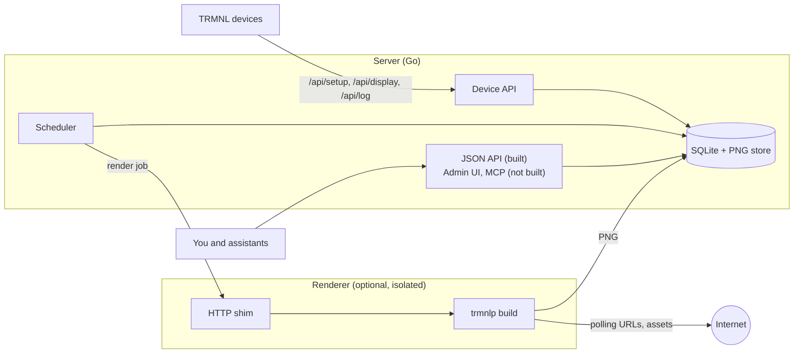

# TRMNL BYOS Server in Go: Design

## Summary

We will build a small Go + SQLite server that speaks the TRMNL device protocol, pre-renders every screen before the device wakes, and renders TRMNL recipes unmodified by driving trmnlp in an optional, isolated renderer process. The first deployment is two 7.5" OG DIY kits on a Proxmox container, but nothing is hardcoded to that panel.

**Goals**

- Support every model in TRMNL's registry: 1-bit, 4-gray, 16-gray and the limited color palettes, at any size and scale factor.
- Run TRMNL recipes (settings.yml + Liquid + transforms) with the same output as TRMNL's own renderer.
- Keep the device awake as briefly as possible: one fast request per wake, no download or repaint when nothing changed.
- Small, boring operations: one static Go binary, one SQLite file, no database or queue server.
- Easy for an AI assistant to extend: recipes as the plugin format, an MCP server for authoring and previews.
- Safe firmware updates: never send a build to a board it was not built for.

**Non-goals for v1**

- Multi-user accounts. One admin, or auth delegated to a reverse proxy.
- A drag-and-drop screen designer.
- Proxying to the TRMNL cloud, OAuth plugins, and native (non-browser) rendering. These are designed for and deferred (see [Deferred work](#deferred-work)).

## Alternatives considered

No existing server combines faithful recipe rendering with a small footprint, so we build one and borrow their best ideas.

| Option | Stack | Why not | What we borrow |
| --- | --- | --- | --- |
| Terminus | Ruby/Hanami, Postgres, Valkey, Sidekiq, Chromium (4 containers) | Heaviest stack. Own Liquid with 15 of ~25 TRMNL filters, always uses the latest framework, no transforms. Playlist cursor is shared across devices and advances on every wake. | Per-device button command, sleep windows, extension refresh schedules, detailed device logs, model and firmware sync jobs |
| byos_next | Next.js, Postgres, optional Chrome | Last commit Jun 30. Own Satori-based screens looked weak. | Little |
| Inker | NestJS, SQLite, Chromium | Moving to an Inker-native ecosystem. Imitation TRMNL CSS (~300 lines). Sends 8-bit gray PNGs, so the OG shows black and white only. | Per-item durations with drift-free timing, clock-aligned wakes, shared data sources, encrypted plugin secrets, device blocklist, live UI events |
| LaraPaper | PHP/Laravel, SQLite, Chromium | PHP. Approximate Liquid by default, no transforms, user Blade templates run as PHP. | MCP server, time-limited join window, scheduled playlists, alias endpoint, staleness flags, cloud proxy (deferred) |
| Ogre (pure-Go HTML to PNG) | Go library | Bugs in basics (borders, SVG strokes, truncation, min-width), one maintainer, 13 outside PRs unreviewed. Cannot run the framework's JavaScript, so it can never render recipes. | Kept as a possible native renderer later |

**Why trmnlp.** trmnlp is TRMNL's own plugin development tool (MIT). It uses the official `trmnl-liquid` gem, the real page wrapper with pinned framework versions, runs transforms in Python, JS, Ruby and PHP, and copies TRMNL's quantization per palette. It is the closest open reference to how the cloud renders a recipe.

## Architecture

A Go server owns all state and answers devices from cached PNGs; an optional renderer, trmnlp behind a small shim, does the rendering. The server streams each job to it, and the two share no files.

Device requests never wait on a render: the scheduler renders ahead, the shim runs one `trmnlp build` per job, and the PNG lands in the store by content hash.

- **Server**: device API, scheduler, store, the bearer-token JSON API, webhook ingest, the web UI's login page, shell and Devices list, and the CLI in one binary. The rest of the web UI and the MCP server are not built. The scheduler and the asset cache sweep run only when `-render-url` is set.
- **Renderer**: the `trmnl/trmnlp` image plus `trmnl-render`, a small Go shim (`deploy/renderer/Dockerfile`, `cmd/trmnl-render`, `internal/render`). The server POSTs a build job as one tar stream: the first member is `job.json` (size, palette, secret values) and the rest are the recipe project. The shim reads the job, then extracts the other members into a fresh directory, confined with `os.Root`, runs `trmnlp build` as an unprivileged user with its temporary and cache directories inside that directory, and streams back a tar of the build log and the four PNGs. If Xvfb exits, `trmnl-render` exits with an error, so the container restarts. A build gets at most 5 minutes from the server (the shim's own limit is 2). The renderer holds nothing between builds and shares no files with the server. How it is isolated depends on how it is deployed, but in every deployment its only way to the internet is the server's filtering proxy (see Renderer network).
- **Shutdown.** `serve` runs both HTTP servers and the loops (image expiry, the scheduler, the asset cache sweep) in one `errgroup`. When the process is told to stop, or any of them fails, such as a server that cannot listen, the rest are stopped, and the database is closed only after all of them have returned. A render in flight is canceled, not finished.
- **Asset cache**: the renderer's proxy caches the framework's CSS, JavaScript, fonts and images, Highcharts, and Google Fonts on the server's disk, so each is fetched from the internet once, and recipes pinned to old framework versions keep rendering.

## Device protocol and profiles

The server implements the three endpoints TRMNL firmware calls, and never renders inside a device request.

| Endpoint | Request | Response |
| --- | --- | --- |
| `GET /api/setup` | `ID` (MAC), `Model`, `FW-Version`, `Width`, `Height` | A new `api_key`, `friendly_id`, and an empty `image_url`, so the firmware draws its own screen with the friendly ID. Accepted only while the join window is open. |
| `GET /api/display` | `Access-Token`, battery, RSSI, `Refresh-Rate`, `Update-Source`, `special_function`, `Wake-Time`, `Image-Cached`, `SENSORS`, `Width`/`Height` | `image_url`, `filename`, `refresh_rate` (a number), `special_function`, `update_firmware`/`firmware_url`, `reset_firmware`. The firmware also reads `temperature_profile` and `maximum_compatibility`, which the server does not send. |
| `POST /api/log` | Firmware log entries | Stored per device with wake reason, heap and Wi-Fi state |

**What is built.** The three endpoints above, the status codes below, profile resolution from step 2 on, the image size limit, gray calibration, the join window, device delete, the MAC blocklist, and `reset_firmware` for a deleted device or one whose key a later setup replaced. The rest of this section says what is not built where it comes up, and the list at the end of it gathers them.

**Status codes.** The firmware reads the JSON `status` field, not the HTTP status, so `/api/setup` and `/api/display` answer HTTP 200 with the outcome in the body.

- `/api/setup` sends 200 for a registered device. For an unknown MAC, or any MAC while the join window is closed, it sends 404 with an `image_url`, which the device shows before trying again every 5 minutes. A blocked MAC gets 404 with a "Blocked" screen, even while the window is open.
- `/api/display` sends 0 for a normal response. The firmware ignores a response whose status is 200.
- An unknown device or a wrong token gets 202. The device keeps its credentials, shows its own setup screen, and polls again soon.
- Status 500 and `reset_firmware: true` both make the device erase its key, friendly ID, Wi-Fi settings and server URL, then start its setup portal. No response clears only the key. The server never sends 500. It sends `reset_firmware` to a request that holds a key and comes from a deleted device's MAC, or from a registered MAC whose key a later setup replaced. Such a device would otherwise keep its old key, never run setup again, and sit on its setup screen. Only `/api/display` sends it: the firmware does not read it from `/api/setup`, and a device calling setup has no key to erase.
- A blocked MAC gets HTTP 200, status 0, a server-drawn "Blocked" screen saying the device is blocked by its server, with its MAC, and a `refresh_rate` of a day. That is one request a day, a screen that says why, and no stale data. It is never 202, whose setup screen says nothing about a block and fast-polls after every reboot, and never a reset. The screen's `filename` is its content hash, as for every system screen. Nothing of the request is saved, no playlist moves, and no firmware is offered. `/api/log` answers a blocked device 403.
- An internal failure in `/api/display` (a lookup, drawing a screen, saving state) answers HTTP 200, status 0, no `image_url` and a `refresh_rate` of 5 minutes. In the firmware (`handleApiDisplayResponse` in `display_session.cpp`) that keeps the screen the device has and sleeps for `refresh_rate`. An HTTP error would instead be five quick retries in `HttpRetryRequest::execute`, then a 5 minute sleep, and a Wi-Fi error screen after an hour of failures (`requestErrorScreen`).
- An unknown MAC, or a request with no `ID`, is never reset. It may mean the server lost its database or is reading the wrong data directory, and a reset then would wipe every display at once.

**Device profile.** Each device resolves to a profile: width, height, rotation, offsets, scale factor, palette, plus the framework's CSS parameters (CSS screen size, pixel ratio, dither pixel ratio, density class). Resolution order:

1. Per-device override set in the UI (not built yet).
2. The firmware `Model` header mapped to a registry model. Firmware names differ from registry names (`xiao_epaper_display` and `og` map to `og_plus`; `x` maps to `v2`), so `internal/profile` keeps a mapping table, which also holds per-board size limits and measured gray levels. A `Model` that is itself a registry name, such as `xteink_x4`, needs no entry. Firmware 1.8.10 and older reports `og` for the 4-color OG too, which only the override can tell apart; newer firmware reports `og_4clr`.
3. For an unknown `Model`: the `Width`/`Height` headers, with black and white only and the smallest size limit. Matching size alone against the registry would be a guess, since a dozen models are 800x480.
4. With no usable headers either: 800x480, black and white.

The registry is a copy of `trmnl.com/api/models` and `/api/palettes` embedded in the binary and refreshed with `go generate`, never fetched per request. Refreshing it daily at runtime is deferred.

**Image size limit.** The firmware refuses an image body over `MAX_IMAGE_SIZE`: 90,000 bytes on a build without PSRAM, such as the original OG's ESP32-C3, and 750,000 bytes with it. The OG DIY kit's build gets PSRAM from the XIAO ESP32-S3 board definition, so it has the larger limit. The registry carries the limit as `image_size_limit` (90,000 for most TRMNL models, 750,000 for the TRMNL X, none for most third-party clients). The firmware table overrides it where a board's build is known to differ, as the DIY kit's is. A device whose model is unknown gets 90,000.

- Every stored image's size is known: the image store records it when the image is written, and each render row keeps it.
- `/api/display` checks the size against the requesting device's limit every time it hands out an image, not only when the image is rendered. One render can be shared by devices with different limits, and a device's model can change after a firmware update.
- An image over the limit is never handed out. The device gets a small "too large" screen with the image's size, the device's limit and a hint to try a palette with fewer grays, and a short `refresh_rate`. A device would otherwise fail the download on every wake and keep showing what it had. Naming the recipe on that screen is not built.
- Not built: a recipe page that shows its renders' sizes against the smallest limit among the devices that show it, and warns past 80%, before a device ever fails. Today `render_image.bytes` holds the sizes and the check runs at `/api/display`.

Typical screens are far below either limit: 2 to 12 KB for the recipes tested. Size grows with dithering, which defeats PNG's compression, and with more levels per pixel, so dithered photos at 16 grays or in color on a device without PSRAM are the case to watch. A plugin instance set to a smaller palette is the fix a person chooses; the server does not quietly fall back to one.

**Gray calibration.** The registry's gray palettes assume evenly spaced levels, and no measured brightness for any panel's levels has turned up. `trmnl-byos calibrate` shows a device a screen where each middle gray sits over black-and-white ordered dither patches with 1 to 15 of every 16 pixels black. The patch that matches from arm's length measures the level to about 1/16. `-dot 2` draws the dither with 2x2-pixel dots, to check whether the panel blurs isolated single pixels and skews the result.

The OG DIY kit measured 2/16 and 6/16 of white's light for its dark and light grays. Evenly spaced light would be 0.33 and 0.67, so the panel's grays are not evenly spaced in light. They are within measurement error of evenly spaced sRGB values (`#555555` and `#aaaaaa` give off 0.09 and 0.40), so TRMNL's palette is right if read as sRGB.

The server draws its own screens as ink coverage and maps each pixel to the level whose measured light is nearest the light the pixel should give off. Measured levels are kept per firmware model; a model not yet measured is assumed to be evenly spaced in sRGB. For the OG this puts glyph edges with 94% coverage or more at black, 75 to 94% at dark gray, 31 to 75% at light gray, and less at white. Blending in sRGB values and rounding, as before, made edges darker and text bolder than the font. Recipes are quantized by trmnlp and are not affected.

**Non-TRMNL clients.** KOReader, Kindle, Kobo, Nook, Android and Raspberry Pi clients speak the same `/api/display`. They may omit firmware headers such as `Update-Source` or the battery fields, so every header is optional.

**Joining and leaving.**

- A time-limited join window (default 10 minutes) admits devices; otherwise setup gets a "not registered" response. The Devices page, `trmnl-byos join` and `PUT /api/v1/join` open it.
- A known MAC needs the window too, since anything on the LAN can see a MAC. A device that lost its credentials re-pairs while the window is open and keeps its friendly ID and settings. Each setup issues a new key and retires the old one.
- `device delete` (or `DELETE /api/v1/devices/{id}`) deletes a device with its state, cursor, logs, playlist links, firmware offers and renders, in one transaction that also keeps its MAC in `device_tombstone`. A rollout whose canary it was goes too, so nothing more is offered to its model until a rollout names another canary. The device still holds its key, and each request with it gets `reset_firmware`, since an unknown MAC is never reset. After the reset the device runs setup, which needs the join window, and registers as a new device with a new friendly ID. That setup removes the tombstone. Its images go once image expiry finds no row that names them.
- A request that found the device just before a delete gets the internal-failure answer: saving its state fails on the foreign key, so no row of the deleted device comes back. Its next request is reset.
- `device block` (or `PUT /api/v1/blocklist/{id}`) puts a MAC in `blocked_mac`, given as a MAC, registered or not, or a registered device's friendly ID. Blocking does not delete. A registered device keeps its row, its key is refused while it is blocked, and the scheduler builds nothing for it, so its renders that no other device shows are pruned. `device unblock` gives it back as it was, with its key and no setup. A block is by MAC, so it outlives the device row, and it wins over a tombstone. To keep a device out, delete it and block its MAC. It is then never reset while blocked, and an unblock lets the tombstone reset it into setup. `device blocked` and `GET /api/v1/blocklist` list the blocked MACs.
- A page refuses to act on what it no longer shows. `device.ReadStanding` returns a MAC's `Standing`, by MAC or friendly ID: its registered device's ID (0 for none), whether it is blocked, whether it has a tombstone, and the firmware builds whose rollout has the device as canary. A page shows it and posts it back, and `Delete`, `Block` and `Unblock` read it again in their transaction and compare. On any difference they change nothing and return `device.ErrDeviceChanged` (a conflict, 409). The device ID is what tells a page's device from a newer one that got the same friendly ID after a delete. An unblock page uses the tombstone to say what an unblock does: a tombstone resets the device into setup, and a registered device is back as it was. An unblock of a MAC that is not blocked is `ErrNotBlocked` (404) whatever the page saw. The command line and the API pass no standing and are not checked.

**Not built.** These are designed and nothing implements them yet:

- A per-device profile override (step 1 above), and with it the 4-color OG on firmware 1.8.10 and older.
- Per-device settings: time zone, locale, button command, sleep window and `special_function` handling.
- Sensor readings. `SENSORS` is not stored.

## Scheduling and pre-rendering

Every screen a device might ask for is rendered before it wakes, and an unchanged screen costs the device one short request and no repaint.

**What the firmware gives us.** If `filename` matches a file in its flash cache, the firmware skips the download. If that image is already on the panel, it also skips the repaint (`displayed_image.h`). It reports the previous wake's duration in `Wake-Time`, which `trmnl-byos device list` and the JSON API show. A dashboard that plots it is not built.

**Rules.**

1. `filename` is the first 16 hex digits of the PNG's SHA-256. Same pixels, same name. The firmware keeps at most 31 characters of a filename as-is.
2. `/api/display` is a SQLite lookup plus a static file. If nothing is ready it shows a system screen: "Rendering" with a 60 second `refresh_rate` before an instance's first render, "Could not render" with the error and the retry rate after a failed first build, and "Out of date" once the last good render is past its stale limit (see Staleness). A device with no playlist items gets a "Connected" screen. A device that has items but none scheduled now gets "Nothing scheduled now" (see Playlists).
3. `refresh_rate` starts at the `refresh_seconds` setting (default 15 minutes) and is shortened to the seconds until the current playlist item ends, to the next schedule change (the next time a playlist or item schedule opens or closes in a way that changes what the device shows, searched up to the rate it would otherwise send), to 60 seconds while a first render is pending, to the retry rate after a failure or "Out of date", to the end of a calibration override, or to the short rate of a "too large" screen. The device chooses at the wake plus the 30 seconds a wake may come early, so the search for a change starts there, and the device is woken at the change itself, as at the end of an item. The rate is rounded up to a whole second. Not built: aligned wakes a plugin asks for (on the minute, on the hour) and sleep-window edges.
4. Next wake = last request + the `refresh_rate` we sent. A render is built ahead of the wake that would show it, with a lead time that covers two build durations (the target's last one, 30 seconds if none, and the same again for a build already running when it becomes due), the 30 seconds a wake may come early, and the scheduler's 30-second check interval.
5. Not built: each device always has three screens ready, current (for button and power-on wakes), next (for skip and touch-bar next) and a short history (for rewind). There is no `device_screen` table. A device gets the newest render when it wakes.

**Renders follow data, not wakes.** A plugin instance re-renders only when its `refresh_interval` comes due or its data changes. Wakes in between get the same filename. This matters because 8 of the top 25 recipes print the time or use randomness, so their output differs on every render.

**Render cache key.** (plugin instance, device, width, height, palette), and one build makes all four layouts. For most recipes the device is 0, so two OGs showing the same weather share one render. A recipe with any file that contains `trmnl.device` (markup, a polling URL in `settings.yml`, or a transform) gets one render per device instead, built with that device's values. The scheduler scans an installed recipe's files once, since they never change, and remembers the answer in memory by recipe ID. The device API looks up the device's own render first and falls back to the shared one. The `render` table has no foreign key on `device_id`, because 0 is no device, so a trigger deletes a deleted device's renders and their images. An older database whose `render` table has no `device_id` has both render tables dropped at startup. The scheduler builds them again.

**What is built.** The scheduler (`internal/scheduler`) scans for due targets, and sleeps 30 seconds only when a scan builds nothing. It looks at each instance in a playlist linked to a device, at the size and palette that device needs. A device's next wake is its `last_seen` plus the `refresh_rate` we sent. The playlist it shows then is the one chosen at that wake plus 30 seconds (see Playlists), and the item is what the playlist cursor gives for that time with no button press, with the items that are hidden or off schedule then skipped. That item's targets are wanted at that wake. A per-device target is wanted only by its own device, and a shared one by every device that will show it. A target is due when:

- it has never been rendered;
- its last build failed and its backoff has passed: 5 minutes after the first failure, doubling with each failure in a row, to at most an hour. `render.failures` counts them and a success resets it. A failure to reach the renderer (`render.ErrUnavailable`: a refused or reset connection, a timeout, a busy shim, a 5xx) is recorded but not counted, because it says nothing about the recipe. A job the client refuses to send for its size, or the shim refuses with a 400 (`render.ErrRejected`), is a failed build and counts: it comes from the instance's settings and would be refused again. So is a project the server cannot write, such as a recipe whose files went after the scheduler scanned it: the client returns the write's error, not `ErrUnavailable`, so it does not blame the renderer. Otherwise every target would sit at the one hour wait after a long outage, and devices would stay stale for up to an hour after the renderer returned. While a failure is the latest result, nothing else makes it due, except a change to the instance's settings (the last rule);
- it is wanted at a wake at which its last good render would be older than the recipe's `refresh_interval`, and that wake is less than the lead time away (or already past);
- its last good render is two refresh intervals old, wanted or not. This bounds the age a button press can reach, and keeps every render younger than the age at which a device shows "Out of date", so scheduling never causes that screen;
- no device showing it has woken yet and the refresh interval has passed;
- its instance's data is newer than what the last build read. Each render records the `updated_at` of the `instance_data` its build read, as `render.data_at`, and the data is newer when its `updated_at` is greater. A push always raises `updated_at`: one in the same second as the stored value is stored one second later, so a push after a build read the data is never mistaken for it. A failed build is retried after its backoff whatever the data, so a push waits for that. The 30 second check and the push rate limit coalesce bursts of pushes, so there is no other delay;
- its instance's settings are newer than what the last build read. Each render records the instance's `settings_at` its build read, as `render.settings_at`, and the settings are newer when it is greater. It is raised by every change to the instance's field values or secrets, by at least a second, so a change after a build read the settings is never mistaken for them. Unlike the data rule, it does not wait for the backoff after a failed build: a settings change is new input, usually the fix for the failure, and a rare admin action that cannot hammer a broken recipe. The failed build recorded the `settings_at` it read, or, if it failed before reading the instance (a recipe that cannot be scanned), the one the scan saw when it found the target due, so the rule fires once for each change on every path. Recording 0 there would make a target whose settings ever changed due on every scan.

Each scan builds one target, the one wanted at the earliest wake, and then scans again at once if it recorded an outcome, so a target that becomes urgent while others are queued is built before them. Targets due only by the last two rules go after those. A scan reads every `render` row in one query (without the logs). The delay before a due target's build starts is the build in progress plus a scan, which is what the lead time allows for. If a scan or the write of an outcome fails, the scheduler waits for the next check instead of spinning. A failed build records its error and log and keeps the last good images. A target that cannot be built at all, such as one whose recipe directory is missing or unreadable, is recorded the same way without calling the renderer, with the reason as its error. Its devices show "Could not render", it is retried with the same backoff as any failure, and the other targets still build. A build that takes over 5 minutes is canceled and is recorded as a failure that does not count toward the backoff, like any timeout. Pruning keeps every render of an instance whose recipe could not be scanned in that pass, since it is not known which of them are per device.

Before it builds, the scheduler deletes every `render` row that matches no target: an instance that left every playlist, or a size or palette that no device has now (a device of an unknown model that reported a new size, say). The images in `render_image` go with the row by cascade, so image expiry can delete them. A target is every item of every playlist a device is linked to, except the hidden ones, at the size the device last reported, so a device never loses a render it could show at its next wake. A hidden item's renders are deleted, and built again when it is shown again. An item that is only off schedule keeps its renders, so they are ready when its window opens. A removed instance that is added back is built again. Rule 5 (a current, next and history screen per device in `device_screen`) is not built: a device gets the newest render when it wakes. Aligned wakes and sleep windows are not built either, so a wake time is only what we sent.

**Staleness.** A device shows an item's last good render until it is older than two refresh intervals plus an hour. After that it shows "Out of date" with the render's age in whole hours ("over 3 hours") and its last error, and wakes again in 5 minutes. The age is coarse so the screen, and its filename, stay the same from wake to wake and the device does not repaint. The server remembers the image name of at most 256 system screens, and forgets them all past that, which costs one redraw each. Before an instance's first render it shows "Rendering", and wakes in a minute, or "Could not render" with the error. A render whose image is missing from the image store is treated the same as one that does not exist yet: the device API deletes the row, if it still names that image, shows "Rendering", and the scheduler builds the target again at its next check. A configurable age, and skipping the item instead, are later work.

## Playlists, mashups and input

Rotation is time-based and tracked per device: each item shows for its own duration, and two devices on one playlist never steal each other's turns.

**Model.**

- A device has one or more playlists, tried in priority order. A link's priority is the playlist's index in the device's order, 0 to n-1 with no gaps and unique per device, so 0 is tried first; linking, moving, unlinking and deleting a playlist keep it that way. A playlist has an optional schedule. The first playlist that is scheduled now and has at least one item to show wins, so an unscheduled playlist at the lowest priority is the default, and a scheduled playlist whose items are all hidden or off schedule falls through instead of blanking the device. If none qualifies, the device shows the "Nothing scheduled now" screen.
- A playlist item is either one plugin instance at full layout, or a mashup: a layout (left/right, top/bottom, quadrants) with a plugin instance per slot.
- Each item has a duration, or none. An item with no duration stays until a button or touch-bar press, with a long `refresh_rate`.
- Items carry their own schedule and a hidden flag. A hidden item, or one whose schedule is not active, is skipped. Items can be moved to another index in their playlist.
- **Schedule.** One shape serves playlists and items (the original design gave playlists only days and a window). `days` is a bitmask, bit 0 Sunday to bit 6 Saturday, 127 for every day, and 0 is invalid. `window_start` and `window_end` are minutes after local midnight, 0 to 1439. Equal means all day. An end before the start wraps past midnight and belongs to the day it starts on, so a Friday 22:00 to 06:00 window covers Friday 22:00 to Saturday 06:00 when Friday is in `days`. `starts_at` and `ends_at` are Unix seconds, 0 for unbounded, and the schedule is active in [`starts_at`, `ends_at`), with `starts_at` before `ends_at` when both are set. The default schedule is always active. Days and windows are read on the wall clock in the server's time zone (`TZ`), so a window follows a daylight saving change. The server's time zone is `TZ`, or UTC when `TZ` is unset, and the server refuses to start on a name it does not know. Recipes render in it, schedules are read in it, and the web UI and the CLI show and take dates in it, so all of them agree.
- **Choosing.** `playlist.Choose` evaluates schedules at the wake plus 30 seconds, the same slack the cursor uses for the end of an item, so a timer wake a little early does not choose the old playlist and sleep for a few seconds. The scheduler evaluates at its predicted wake plus the same slack. `playlist.NextChange` finds the first time after that at which the chosen playlist, or which of its items are shown, changes. It tries each schedule's window starts and ends for the local days involved, local midnights, `starts_at` and `ends_at`, and the times the UTC offset changes, and returns the first that gives a different choice, so a midnight between two listed days or a window that opens in a playlist that is not chosen is not a change.
- **Nothing scheduled.** A device that has playlist items but no playlist that is scheduled and has an item to show gets a screen with "Nothing scheduled now", its friendly ID and "None of this display's playlists is scheduled for now." The text is constant, so the image name is too, and its `refresh_rate` is the usual one shortened to the next schedule change. A device with no items still gets "Connected".

**Cursor.** Stored per device as (current item, started at), in `device_cursor`, a table of its own. A device that has no cursor has no row. `device_state` holds only what the device reported, so a row there means the device has woken, and a cursor never creates one. When a wake finds the duration elapsed, the cursor moves to the next item and the new start time is the old start plus the duration, so timing does not drift. A timer wake up to 30 seconds early counts as the end of the item, since deep-sleep clocks drift, so items last at least a minute. After a long sleep, whole turns through the playlist are skipped at once. A cursor on an item that was deleted, or is no longer in the device's playlist, starts the playlist over at the first item that is shown. A cursor on an item that is now hidden or off schedule moves to the next item that is shown, starting now, as does a press. Whole turns sum only the durations of the items that are shown. `refresh_rate` is the device's usual rate, or the time left in the item or until the next schedule change if that is shorter.

**What is built.** Playlists (`internal/playlist`): a device shows the first of its linked playlists that is scheduled now and has an item to show, items are full-layout instances with a duration or none, and a press (`button`, `EXT0` or `EXT1`) moves to the next item that is shown. Playlist and item schedules, hidden items and reordering are built. Mashups, the sleep window, `special_function`, and per-device button commands are not built yet. Playlists are edited with `trmnl-byos playlist add|remove|list|move|set|schedule|create|rename|delete|link|unlink|order`. `create NAME`, `rename NAME NEW` and `delete NAME` manage a whole playlist (names are trimmed, 1 to 64 bytes, unique, and `delete` removes its items and links), where `remove ITEM` removes one item. `link NAME DEVICE` links a device last and leaves an existing link where it is, `order NAME DEVICE FROM TO` moves an existing link from index FROM to index TO in the device's order (it never makes a link. It reads the device's order and refuses a FROM the link is not at as a changed order, then passes the order it read to `playlist.MoveLink`, which refuses the move as a changed order if the device's links differ by then, and then refuses a TO outside 0 to n-1, `-1` included), and `unlink NAME DEVICE` removes the link. A link and an unlink renumber the device's priorities. `playlist add` makes the playlist if it is missing (named by `-playlist`, or the device's friendly ID), through `playlist.AddItemCreating`, which creates it in the add's transaction, so a refused add makes no playlist. `playlist.AddItem`, which the API and web UI use, never creates one: it takes a reference to an existing playlist and returns `ErrNoPlaylist` otherwise, so a stale page or a mistyped name cannot make one. Adding an item for a device links it last only if it is not linked, and never changes the priority of an existing link. `move ITEM INDEX` moves an item. `set ITEM` changes only the flags given of `-duration`, `-hidden`, `-days mon,tue`, `-window 09:00-17:00` (or `all`), `-from YYYY-MM-DD` and `-until YYYY-MM-DD`, where both dates are inclusive days in the server's zone and an empty value clears the bound. `schedule NAME` takes the schedule flags for a playlist. `list` shows every playlist's schedule and each item's index, schedule and hidden flag. Positions are an item's index, 0 to n-1 with no gaps, which a move and a delete keep and migration step 4 made true of existing rows. Migration step 5 did the same for priorities and added the unique index.

**Input (planned, mostly not built).** The headers say what woke the device; we never guess from timing. Built today: `playlist.Advance` treats any press (`button`, `EXT0`, `EXT1`) as next, and a timer wake advances when the duration has elapsed. The rest of this table and the paragraphs after it are design only.

| Signal | Source | Action |
| --- | --- | --- |
| `Update-Source: timer` | Scheduled wake | Advance if the item's duration elapsed |
| `Update-Source: button`, `EXT0` or `EXT1` | Single press. The value is the ESP32 wake source, so it depends on the board: the OG DIY kit sends `EXT0`. | The device's configured command: next (default), previous, first, or refresh |
| `special_function` header | Double click, or the TRMNL X touch bar | `rewind` shows the previous screen from history, `restart_playlist` jumps to the first item; others as configured |
| Touch bar right | TRMNL X | Next |

Planned: the `special_function` value in our responses is a per-device setting, sent on every response as the docs require. Today it is always `none`, and the request header is not read.

**Sleep window (not built).** Per device, for example 23:00 to 06:30: show a sleep screen and set `refresh_rate` to the window's end.

**Mashups (not built).** Only the `playlist_slot` table and `playlist_item.layout` exist, and `AddItem` writes slot 0 and layout `full`. The plan: the framework renders a mashup as one page with mashup classes. trmnlp cannot put several recipes on one page: it renders each of a recipe's half and quadrant layouts on a full-size page, inside a one-slot mashup in the slot's position (the half-horizontal layout fills the top half). So the server composes a mashup by cropping each slot from its recipe's render and placing it, which keeps the framework's slot frame and spacing.

## Plugins and rendering

The plugin format is the TRMNL recipe, unmodified, and the renderer is trmnlp driven through a small shim; the Go server never parses Liquid.

**Recipe format.** A directory or the zip from `trmnl.com/api/plugin_settings/<id>/archive`: `settings.yml`, `full.liquid`, `half_horizontal.liquid`, `half_vertical.liquid`, `quadrant.liquid`, optional `shared.liquid` and `transform.{js,py,rb,php}`. Built: a local directory or zip, installed with `trmnl-byos recipe add` or `POST /api/v1/recipes`, which can be written locally and previewed with `trmnlp serve`. Not built: installing from the TRMNL gallery, the community catalog (`bnussbau/trmnl-recipe-catalog`) or a git URL.

**What the top 25 recipes need** (survey of trmnl.com by popularity):

| Need | Count | Handled by |
| --- | --- | --- |
| Polling strategy | 23 | trmnlp polls during `build` |
| `polling_url` is Liquid, sometimes several URLs (`IDX_0`, `IDX_1`) | 3 multi-URL, many templated | trmnlp |
| Transforms (4 JS, 1 Ruby, 1 Python) | 6 | trmnlp image ships Node, Python, Ruby, PHP |
| JavaScript in the page (3 load Highcharts) | 6 | Browser in the trmnlp image |
| Pinned framework version (7 distinct versions) | 24 | Asset cache |
| `trmnl.device.*` in markup or URLs | 3 | Per-device build with `variables.trmnl.device` |
| Webhook strategy | 1 | Our webhook endpoint writes the data file |
| OAuth | 0 | Deferred |

**Render path.**

1. A recipe is installed into `recipes/<id>/` under the data directory (its row and the rename of its directory are one transaction, so a failed install leaves no row without a directory). A crash between the rename and the commit leaves a directory with no row, which a restored backup, whose IDs repeat, could give to a new recipe, so `serve` sweeps at startup, before the scheduler: it removes each `recipes/<id>` directory with no row, inside a write transaction so it cannot run between another process's rename and commit, and removes `.install-*` and `.upload-*.zip` in the recipes directory and `.upload-*.bin` in the firmware directory that are over an hour old, since a CLI install may be running. A zip member that fails its checksum is refused as invalid input (400). Each refusal says why in a plain sentence, without a Go error text in it: that the file is not a zip archive, is empty, has no `settings.yml` (or no `full.liquid`) where one is looked for, has a file name that leaves its directory, has too many files or is too large once unpacked, has a damaged member (named), or has a `settings.yml` that is empty or not YAML. A recipe whose `settings.yml` has no `name` is called by the name of the uploaded file without its directory (either kind of slash) or extension, which is only text and never reaches the filesystem, and by `upload` when the file has no usable name, as the API's upload does, since it has no file name. The source is a directory or zip that holds `settings.yml` at its top, in `src/`, or inside one top-level directory. Hidden files are skipped, names that would leave the directory are refused, and the server reads only `name`, `refresh_interval` and `custom_fields` from `settings.yml`, the last as the definitions an instance's values are checked against (see Settings). A recipe whose `custom_fields` is not a list, has an entry that is not a map or has no `keyname`, or repeats a `keyname` is refused at install (400). trmnlp fills in field defaults itself. For each build the server streams a project: the recipe's files under `src/`, and a `.trmnlp.yml` with the time zone (from `TZ`), the asset overrides, and each custom field set to `{{ env.FIELD_n }}`, or, for a multi-select, to a YAML list of `{{ env.FIELD_n_k }}`, one per choice, which trmnlp v0.34.1 interpolates element by element, so the recipe's Liquid gets an array as it does on TRMNL. The values travel in the build job. trmnlp runs every `custom_fields` value through Liquid, so a value written into the file would have any `{{` in it run as Liquid. For a recipe that reads `trmnl.device`, the `.trmnlp.yml` also has `variables.trmnl.device` with the device's `friendly_id`, `percent_charged`, `wifi_strength`, `firmware_version` and `refresh_interval_seconds`, from the device row and its state at its last wake. trmnlp does not run `variables` through Liquid, so these values go in the file as typed YAML and are only data. The MAC and api key are never passed. A field the device has not reported is left out, so trmnlp's placeholder shows. `percent_charged` and `wifi_strength` are estimates from the battery voltage (3.0 to 4.2 V) and RSSI (-100 to -50 dBm), not TRMNL's own conversion. The width, height and model come from the build's size, as before. Locale is not passed yet.
2. A script pushes data to an instance with `POST /api/custom_plugins/{id}` (see Inbound data). The server stores it in `instance_data`, and each build writes it into the project's `.trmnlp.yml` under `variables`, at the top level next to `trmnl`, which is trmnlp's documented override for user data. It is written as typed YAML, so a string with `{{ }}` or a newline stays a literal string, and a number stays a number. A pushed `trmnl` key is refused, so the server's own `variables.trmnl.device` cannot be overwritten. trmnlp's own webhook store is a cache file keyed by a hash of the project path, which is an internal detail to stay away from. Tested with Top Hacker News Story: a `stories` list under `variables` reached the templates as a top-level merge variable, next to the usual `trmnl` variables. An instance of any recipe may have data, not only one with `strategy: webhook`. trmnlp polls nothing for a webhook recipe, and its `refresh_interval` rules apply as for any other.
3. When a render is due, the server streams the project to the shim, which runs `trmnlp build --png --width W --height H --palette P` on it and streams the PNGs back. One build polls once and renders all four layouts; there is no option for one layout. A build runs in a process group of its own, and the whole group is killed when it ends or times out, since trmnlp starts Firefox and geckodriver. The container runs with an init process, which reaps what Firefox leaves behind.
4. The server stores the PNG under its content hash. Updating each affected device's ready screens (`device_screen`) is not built.

**Settings.** An instance has a name, field values (some of them secret, because their field is a `password` or the admin marked them) and a palette. The values are checked against the recipe's `custom_fields` (`recipe.Field`, read from `settings.yml` with the scalar text of each value as its string, so `7` is `"7"`, and a plain `yes`, `true` or `on` in any case is `"true"` and a plain `no`, `false` or `off` is `"false"`, as Ruby's Psych, which trmnlp uses, reads them in options, defaults and flags; a quoted one is left alone). settings.yml is read into a tree that takes about 125 bytes of memory for each byte, so it may be at most `MaxSettingsBytes` (256 KB, refused at install as 400, never cut short), and that cap is what bounds the memory; it may not use YAML aliases either, which stops a few thousand aliases of one anchored field multiplying that work. It is parsed on every use with no cache, which costs KB in practice, on admin routes, and a cache keyed by recipe ID would need invalidating once a recipe can be replaced or deleted, since a restored backup can repeat an ID, and a value is a string, or a list of strings for a multi-select. A select option is a plain scalar, whose value is its text in lower case with spaces as underscores as trmnlp stores it, or a one-pair map `Label: value`. A field's `Input()` says how it is shown and checked:

| `field_type` | Input | Checked as |
| --- | --- | --- |
| `string`, `url`, `multi_string`, `time_zone`, `lat_lon`, `xhrSelect`, `xhrSelectSearch`, `plugin_instance_select`, and any other | text | One line, with no carriage return or line feed, and at most `maxlength` characters when given |
| `text`, `code` | textarea | At most `maxlength` characters when given. CR LF and a lone CR are stored as LF, as a browser shows them |
| `number` | number | The HTML number grammar, `-?digits(.digits)?([eE][+-]?digits)?`, so not `+5`, `.5`, `5.` or `0x10`, and within `min` and `max` when given |
| `select` | select | Each value is an option's value, and a list only when `multiple` (one string for a multi-select is a one-element list). A multi-select is stored in option order, whatever order it was given in, and a value two options share (`Red` and `red`, or `Metric: m` and `Meters: m`) once |
| `boolean` | boolean | `true` or `false` |
| `date` | date | `YYYY-MM-DD` |
| `time` | time | `HH:MM`, 00:00 to 23:59 |
| `password` | password | One line, at least 6 characters, and at most `maxlength`. Always stored sealed |
| `author_bio`, `copyable`, `copyable_webhook_url` | none | Display only: a value is refused |

A field's value is secret, and stored sealed, when its field is a `password` or the admin marked it secret for the instance. A recipe often declares a credential as a `string` or `text` field, so the type cannot be trusted to say what is secret. Only a field whose input is `text` or `textarea` can be marked (`Field.CanMarkSecret`). A mark on a select, number, boolean, date, time or display-only field is refused as "cannot be secret, since its value is not text". A password field is always secret: marking it does nothing, and unmarking it is refused. A keyname the recipe lacks is refused as "no such field". The marks are in `InstanceParams.Secret` and `InstanceUpdate.Secret`, the API's `mark_secret` and the CLI's `-secret` and `-plain`. A marked field has the same 6-character minimum as a password, with the same reason. `Field.LooksSecret` guesses from a keyname or label that looks like a credential, such as `api_key`, `apiKey`, `access_token` or `client_secret`. It is only the default a form ticks for the admin, who decides, and nothing is sealed because of it.

A list for any field but a multi-select is refused. An instance stores only values a browser form shows back unchanged, the number grammar, one-line text and option order above, so a form save that changes nothing stores the same values and does not raise `settings_at`. A stored value from before these rules that breaks one is kept until an update gives that field a value, which is then checked like any other: a bad number or a line break is refused, and a multi-select is put in option order. An update that leaves the field out, such as a rename, keeps it, even for a required field. The API and the command line send only the fields they change, so they keep such a value. The web form posts every field, so a form save rewrites a value the form cannot show, and for a required number that a number input shows blank it is refused as required until a value is typed. There are no deployments with such rows, so nothing migrates them. A field is required when it is not `optional` and blank is not an answer, as trmnlp's `blank_is_a_valid_answer?` has it: blank is an answer for a boolean, a field with a `default`, a field with a `conditional_validation`, and a select with an option whose value is blank. A required field needs a value when the instance is made, and an update cannot clear it. A value of only white space is blank, as in trmnlp, and clears a field. A select's default given as an option's label is stored as its value. An update does not check the required fields it leaves out, since the instance had them when it was made and the secrets may not open without the key. `conditional_validation` is ignored, so a field it would make required is only as required as its own `optional` says. Every bad field of a request is reported at once, as one `recipe.FieldErrors` (keyname to message, wrapping `errkind.ErrInvalid`, so the API answers 400 with the messages in `fields`). `time_zone` and `lat_lon` are plain text because it is unconfirmed what TRMNL stores for them (Rails zone names rather than IANA ones, and probably `lat,lon`), and the options of `xhrSelect`, `xhrSelectSearch` and `plugin_instance_select` come from an endpoint the server cannot call.

An update merges into the stored values: a key left out is kept, and a key with an empty value (`""`, only white space, or `[]`) clears a plain field. An empty value for a field that was secret before the update is ignored, so a form that leaves a secret blank cannot wipe it, and a secret is cleared by naming it in `clear` (`InstanceUpdate.Clear`, the API's `clear`, the CLI's `-clear`), which clears a plain field too. A key in both is refused, and so is clearing a required field. A value may not contain a NUL byte, which cannot pass through the environment a build gets values in. The merge and the write are one transaction, and a refused update changes nothing. A form sends back `recipe.InstanceState` of the instance its page showed as `InstanceUpdate.Seen`. That is a hex SHA-256 over the name, the palette, the plain field values and the marks, each part framed by its length so no two states encode alike, and it saves posting every value back, which can come to 63 KB. The update recomputes it inside its transaction and is refused with `ErrInstanceChanged` (a conflict) if it differs, so a save from a page that is out of date does not undo a change made since. The values are digested decoded, as JSON with sorted keys, so neither the stored JSON's key order nor a rewrite of an unchanged value changes the digest. Sealed values are left out: a page never shows them, so a change of only a secret leaves the digest alone, and the check needs no key, so a rename from the page works without one. The API and the command line send no seen state, so the last write wins. A keyname lives in exactly one of `field_values` and the sealed secrets: the sealed ones when its field is a `password` or marked, and `field_values` otherwise. Every change puts all values in their stores again. Marking a field moves its plain value into the sealed secrets. A sealed value is never shown back, so an unmark never moves one into the plain values: unmarking a field that has a sealed value is refused ("is secret; give it a new value or clear it to make it plain") unless the same update gives it a new value or clears it. An unmark with a blank value is refused too, since a blank means keep, and a required field needs the new value. A mark is refused if the existing plain value is shorter than 6 characters. Clearing removes a value from both stores and keeps the mark. Since every change puts each value in its store, a field whose type changed between `password` and another type leaves no stale copy. A sealed value stays sealed: if its field stops being a `password` or leaves the recipe, the next update that opens the secrets marks it, so an edit of another field never shows it. `clear` takes a stored keyname the recipe no longer declares, so a value left from a dropped field can be removed, and its mark can go with it. A keyname that is neither declared nor stored is refused as "no such field", for `clear` and an unmark as for a value, so a typo is not taken silently. Recipe replace, when it is built, must mark such values in its own transaction, so the marks a form shows are right before any update. A change of marks opens the sealed secrets like a change of values, and seals them when the result has any, so it needs the key (without one it is refused with 400), except that marking a field that has no value, on an instance with no stored secrets, needs none. Since the names inside the sealed secrets cannot be known without opening them, an update that changes any value opens them, which needs the secrets key (without one it is refused with 400), and seals them again only if they changed. An update of only the name or palette never opens them, so it works with no key and when the key has changed. An update that has to open stored secrets that do not open is refused (400). The way out is to create the instance again.

Rendering again after a change: `plugin_instance.settings_at` is when the field values or secrets last changed, and rises by at least a second with every change, as a push raises `instance_data.updated_at`. A build records the `settings_at` it read in `render.settings_at`, and the target is due when the instance's is greater. A rename or a palette change does not raise it, nor does a mark or unmark that only moves a value between stores, since a build gets the same values. A palette change already makes a new render target.

On the command line, `instance add -recipe ID` takes `-name`, `-palette` and `-field keyname=value`, repeated for each field and, for a multi-select, for each choice. `-field-file keyname=path` reads a field's value from a file, or from stdin for `-` (once per command), and drops one trailing LF or CR LF. `-field` puts the value in the command line, which `ps` and the shell history show, so a value meant to be secret, such as a password or a key, belongs in `-field-file`. `instance add` takes `-secret keyname`, repeated, to mark a field secret. `instance set ID` takes the same flags, `-secret keyname` to mark a field and `-plain keyname` to unmark one (with a new value or `-clear` when it has a value), and `-clear keyname` to clear a field, a secret too, and changes only what it is given. A key in both `-secret` and `-plain` is refused before the database is opened. A secret field's value is sealed with `TRMNL_SECRET_KEY`. `instance list` prints no field values, so it shows no marks.

Field values travel in the render job's environment, which is at most 64 KB of JSON with the rest of the job, so the values of an instance may come to at most `render.MaxEnvBytes` (63 KB) as the client encodes them, with `<`, `>` and `&` unescaped. Create and update refuse more, as a field error on the largest field, counting every value, secrets included. A multi-select that names a value twice names one choice, and it is stored once. An instance's name is trimmed, at most 64 bytes, valid UTF-8 with no control character, and empty means the recipe's.

Not built: per-device time zone or locale overrides, dark mode, icons and framework version pins. The time zone is the server's `TZ`, and locale is not passed.

**Renderer interface (not built).** There is no `Render(job) -> PNG` interface and no static-image backend. The scheduler calls the shim client (`*render.Client`) directly, and `internal/screen` draws system screens in process. A pluggable interface is the plan, so other backends can be added. An image-URL backend (fetch a PNG such as a Grafana panel, quantize in Go) and a native Ogre backend are deferred.

## Firmware updates

The server is the only thing preventing a wrong-board update, so it offers a firmware build only to devices whose exact firmware model it was built for, and only when asked to.

**Why it has to be the server.** The firmware's OTA path (`firmware_update.cpp`) is `esp_ota_begin` / `esp_ota_write` / `esp_ota_end` with no board check. ESP-IDF's image verification rejects a different chip family (C3 vs S3) but not a different board on the same chip, and app rollback is disabled in the TRMNL X config we checked. A TRMNL X build sent to a XIAO S3 kit would install, boot with the wrong pins, and might need USB to recover.

**Rules.**

1. Each catalog entry names exactly one firmware model (the `Model` header value, e.g. `xiao_epaper_display`), a version, and a SHA-256. No wildcards, no "latest" URL. A model is in the catalog only if it is in the chip table below.
2. On upload, parse the ESP image header (chip ID) and the app description. Reject the file if the chip does not match the model's chip, the image structure or checksums do not hold, or the version disagrees with the entry.
3. Offer an update only if the catalog version is newer than the device's `FW-Version`, the device has updates enabled, and the device is not pinned. Never downgrade or offer the same version. A device version that is not dotted numbers gets no offer.
4. Roll out to one device first. Offer to the others only after that device checks in reporting the new `FW-Version`, or a newer one if it was flashed past the build.
5. Serve only the exact stored file; `firmware_url` points at our server with the hash in the path.

**What is built.** `internal/firmware` holds the catalog, the image checks and the offer rule. The device API offers and serves, and the commands, the admin API and the Firmware page of the admin UI manage.

- **Catalog.** `trmnl-byos firmware add -model M [-version V] FILE` streams the file to a hidden temporary file in `firmware/` under the data directory while hashing it, checks it there, and renames it to `firmware/<sha256>.bin` only when every check passes. A refused upload leaves no file and no row. The upload is bounded by the model's app partition. The `firmware` table has one row per file, and a model has one build per version, compared as numbers (`1.8.19` and `1.8.19.0` are the same version), so two different files cannot claim the same version. Each refusal says why in a plain sentence, such as that the file is cut short, is built for another chip, or is already in the catalog and as which build, without a Go error text in it. `firmware list` shows each build and its rollout, with the canary's version and the time the canary was last offered the build (`LAST OFFERED`, `-` for never), which shows a canary that was told to update and did not.
- **Image checks.** The file must be an ESP app image as `esp_image_format.h` lays it out: magic byte 0xE9 and at most 16 segments, every segment inside the file, the 8-bit checksum, the appended SHA-256 when the header says there is one, and the app descriptor (magic 0xABCD5432) at the start of the first segment. The header's `chip_id` must be the model's chip. This catches a truncated or corrupt upload and a merged flash image (which starts with the bootloader, not an app descriptor). It does not catch the case that matters most, a build for another board on the same chip, since nothing in the image names the board. Only the model the uploader gives does.
- **Version.** The app descriptor's version string is the ESP-IDF project version, which the TRMNL build does not set, so it is a git description, a commit hash or `1`, not the `FW_MAJOR.FW_MINOR.FW_PATCH` the firmware reports in `FW-Version` (that is compiled in from `include/config.h`). So the uploader gives the version, from the release's file name, and it must be dotted numbers with up to four parts. When the descriptor does hold a plain `X.Y.Z`, with or without a `v`, the given version must equal it, and it can be left out. A wrong version is not caught otherwise. A file labelled newer than it is would be installed, report its real version, and be offered again until the offer cap stalls the rollout.
- **Trusted Model header.** Before firmware 1.8.17 the firmware took `Model` from a board macro that two builds shared: `og` was the OG and the 4-color OG, `xiao_epaper_display` was the DIY kit and its 3-color variant, and `x` was two TRMNL X boards (checked at the 1.8.16 tag). A device on firmware older than 1.8.17 may be a different board than its `Model` says, so it is never offered firmware and cannot be a canary. Update such a device by USB or through TRMNL once.
- **Offer.** `/api/display` sets `update_firmware: true` and `firmware_url` (`<base>/firmware/<sha256>.bin`, built like image URLs) only when the build is for exactly the `Model` and `FW-Version` the device sent on this request (a missing header is never filled in from the stored value, though the stored copy keeps its old value when a header is missing); its rollout is active; its version is newer; the device has `updates_enabled`, no `fw_pin`, a firmware version of 1.8.17 or newer, and a model in the chip table; the file is on disk at the size recorded; and either the device is the rollout's canary or the canary now reports a matching model and the build's version or a newer one. Of several builds that qualify the newest is offered. The image and `filename` are still sent, so the device shows a screen if the update fails.
- **Offer cap.** The version label cannot be verified from the binary, and an OTA can fail for other reasons, so a device that does not take a build would be told to update on every wake. `firmware_offer` counts the offers of each build to each device, incremented in the same transaction that decides the offer. A build is offered to a device at most `MaxOffers` (3) times: one try and two retries for a dropped download. After that that device is not offered that build again. A device that reports the build's version is simply no longer older.
- **Stalled rollout.** When the canary has been offered the build 3 times and still does not report its version, the rollout is `stalled`: nothing is offered to anyone. `firmware list` and the API show it with the canary and the version it reported. Restart it with another canary, or with the same canary, which resets that device's count (the admin's explicit retry), or cancel it. The `firmware_offer` foreign key to `device` cascades, so a deleted device's counts go with it.
- **Canary.** A rollout starts with `firmware rollout <id> -canary DEVICE`, and refuses a canary that could not take the build now (blocked, another model, updates off, pinned, already on that version or newer, firmware too old). Until the canary reports the build's version, only it is offered the build. A canary that does not come back on that version leaves the rollout at the canary stage, which `firmware list` shows as `canary` (or `stalled`, below). The other devices keep running their firmware. Pick another canary with `firmware rollout` again, or `firmware cancel <id>`. Choosing another canary closes a rollout that was open until that device reports. A canceled rollout is offered to no one and its file is no longer served. `firmware_rollout.canary_device_id` is `ON DELETE CASCADE`, so deleting the canary deletes its rollout row rather than canceling it. The build is then offered to no one, as when canceled, until a new rollout names a canary.
- **Blocked canary.** A blocked device is offered nothing, so a canary blocked before it reports the build's version would leave the rollout waiting for good. `firmware list`, the API and the web UI show such a rollout's stage as `blocked` (the web UI's badge says "Canary blocked"), and the other devices get the reason `canary_blocked`. Nothing is offered to anyone. The fix is to restart the rollout with another canary, or to cancel it. Unblocking the canary also lets it go on. A canary blocked after it reported leaves the rollout open.
- **Device policy.** `updates_enabled` is off for every device until `firmware device -updates on DEVICE`. `-pin VERSION` keeps a device where it is and `-pin none` clears the pin. The same two settings are in `PATCH /api/v1/devices/{id}`.
- **Per-device standing.** `firmware.DeviceOffers` lists the devices of a build's model by friendly ID, each with a `Reason` code and a sentence. Reason "" means `/api/display`, on a wake with the device's stored model and version, would send this build now. `newer_build` means it would send another, newer build, whose ID is `instead_id`. The other codes say why not: `blocked`, `updates_off`, `pinned`, `wrong_model`, `bad_version`, `old_firmware`, `not_newer`, `bad_build`, `no_rollout`, `canceled`, `canary_blocked`, `stalled`, `waiting_for_canary`, `cap_reached` or `file_missing`. A blocked device cannot be the canary. It also says which device is the canary and which could be the canary now (`can_be_canary`: the device half of the rule passes). `/api/display` and the listing share one decision (`decide` and `pick`: the device half `notEligible`, the rollout half, the newest build first, the first with its file), so the two cannot disagree, except that a wake that leaves out its `Model` or `FW-Version` header is offered nothing. It takes one query for the build, one for the devices with their offer counts, one for the model's active builds with theirs, and one stat of each build's file, however many devices there are. `GET /api/v1/firmware/{id}/devices` returns it.
- **Download is not authenticated.** The firmware's OTA code (`firmware_update.cpp`) fetches `firmware_url` with a bare `HTTPClient::GET()`, or `g_modem->httpGet` with no headers on the TRMNL X's modem path. It sends no `Access-Token` and no `ID`, so the route cannot ask for either, and `GET /firmware/{sha256}.bin` is open, like `/images`. It is limited to what a rollout names: the hash must be 64 lowercase hex digits (checked before the filesystem), the build must be in an active rollout, and the file must be the size recorded. It is served with `http.ServeContent`. The file is not secret, but a LAN client that knows a hash can fetch it while the rollout lasts. The firmware's `_firmwareUrl` buffer is 1024 bytes, which our URLs are well inside.
- **Failure behavior.** A failed OTA is recorded by the firmware, which will not try again for 24 hours and keeps running what it has. A successful one reboots. The firmware has no rollback and no board check, so everything above is about not sending a bad file.

**Chip table.** It is `Models` in `internal/firmware/models.go`, built from usetrmnl/trmnl-firmware at commit 744a955 (`platformio.ini` and `boards/`). Each model's PlatformIO environment gives its `DEVICE_MODEL` string, its board (hence the chip) and its partition table (hence the largest image the model can take). Chip IDs are from ESP-IDF's `esp_chip_id_t`: ESP32-C3 0x0005, ESP32-S3 0x0009, ESP32-C5 0x0017.

| Chip | Models | App partition |
| --- | --- | --- |
| ESP32-C3 | `og`, `og_4clr`, `xteink_x3` | 1,900,544 bytes (0x1D0000, `min_spiffs.csv`) |
| ESP32-C5 | `og_gen2` | 2,621,440 bytes (0x280000, `trmnl_gen2_partitions.csv`) |
| ESP32-C5 | `og_gen2_4clr` | 3,145,728 bytes (0x300000, `trmnl_x_partitions.csv`) |
| ESP32-S3 | `x`, `lilygo_t5pro`, `m5_papers3`, `m5_paper_color`, `seeed_sticky`, `reterminal_e1003`, `reterminal_e1004` | 3,145,728 bytes |
| ESP32-S3 | `reterminal_e1001`, `reterminal_e1002`, `waveshare_397`, `xiao_epaper_display`, `xiao_epaper_3clr`, `xiao_epaper_6clr`, `xiao_epaper_mini` | 1,900,544 bytes |

Left out, so they cannot have firmware added: `xteink_x4` (two builds share the name, one for a push-to-refresh power button), `trmnl_steam` (a development build), `crowpanel42` and `m5_paper_mono` (no partition table is set in the source, so the board default applies, which it does not state), `sensoria_s3` and `sensoria_c5` (not confirmed against a current environment), and the generic `seeed_esp32c3`, `seeed_esp32s3` and `waveshare` names. A model that is in the source under a different name than an older device reports gets no offer, since the name has to match.

**Sources.** Builds you upload. Official releases synced from TRMNL on a schedule (as Terminus does), going through the same checks, are not built yet. Taking `update_firmware`/`firmware_url` from the TRMNL cloud via the deferred cloud proxy is another option, since the cloud already picks per device.

## Data model

One SQLite file (WAL mode) holds all state; rendered PNGs and recipe sources live on disk next to it, addressed by hash.

**What is built.** The tables in `internal/db/schema.sql`:

| Table | Key fields |
| --- | --- |
| `device` | mac, api_key_hash, friendly_id, name, fw_model, fw_version, created_at, updates_enabled, fw_pin, screen_override, screen_override_until |
| `device_state` | device_id, last_seen, last_refresh_rate_sent, last_image, battery_v, rssi, wake_time_ms, update_source, width, height. A row exists once the device has called `/api/display` |
| `device_cursor` | device_id, item_id, item_started_at (the playlist cursor; deleted with the device) |
| `device_log` | device_id, received_at, device_at, level, message, detail (the entry as sent, with wake reason, heap and Wi-Fi state); the newest 1000 per device are kept. Written by `POST /api/log`, and no command or route reads it yet; read it with `sqlite3` |
| `recipe` | id, name, source (the path installed from, or `upload`; the web UI shows `Uploaded` or the path's last element, with the whole path as a tooltip), refresh_interval, installed_at |
| `plugin_instance` | recipe_id, name, field_values (a JSON object of strings, or arrays of strings for a multi-select), secret_values (sealed, the values of the `password` fields and the marked ones), secret_keys (a sorted JSON array of the keynames the admin marked secret, `[]` for none; plaintext, since a mark is not a secret and a form needs it without the secrets key, and it names no value), palette (empty for the device's own), created_at, settings_at (when the field values or secrets last changed, 0 for never) |
| `instance_data` | instance_id, data (the merged webhook JSON object), updated_at (rises with every push) |
| `playlist` | name, and its schedule: days, window_start, window_end, starts_at, ends_at (see Playlists) |
| `playlist_device` | playlist_id, device_id, priority (the playlist's index in the device's order, 0 to n-1 with no gaps, unique per device) |
| `playlist_item` | playlist_id, position (the item's index in its playlist, kept dense), layout, duration, hidden, and the same schedule columns as `playlist`. `layout` is always `full` and nothing reads it, since mashups are not built |
| `playlist_slot` | item_id, slot, instance_id. `slot` is always 0 until mashups, which put several instances in one item |
| `render` | instance_id, device_id, width, height, palette, rendered_at (last good build), attempted_at, duration_ms, error, log (latest build), data_at (the instance data's `updated_at` the latest build read), settings_at (the instance's `settings_at` the latest build read), failures (builds failed in a row) |
| `render_image` | render_id, layout, image, bytes |
| `firmware` | fw_model, version, sha256 (lowercase hex, also the file name), chip, idf_version, bytes, source, uploaded_at; one build per model and version |
| `firmware_rollout` | firmware_id, canary_device_id, state (active or canceled), started_at |
| `firmware_offer` | device_id, firmware_id, offers, last_offered_at. `last_offered_at` is shown as the canary's last offer time in `firmware list` and the API |
| `api_token` | name, token_hash (SHA-256), created_at, last_used_at (0 until used) |
| `setting` | key, value, updated_at. The join window (`join_until`), the admin password hash (`admin_password_hash`, a PHC string), and the settings an admin can change (`refresh_seconds`, `min_password_length`; see Admin settings) are kept here |
| `admin_session` | token_hash (SHA-256), created_at, last_seen_at, expires_at. One row per signed-in browser |
| `device_tombstone` | mac, deleted_at. A deleted device's MAC, kept until that MAC completes a new setup, so its requests are reset. A MAC is never both a device and a tombstone |
| `blocked_mac` | mac, blocked_at (the first block). Every blocked MAC, registered or not. It is apart from `device` so a block outlives a delete and covers a MAC that never registered |

**Not built.** These tables and columns are designed and do not exist:

| Table or column | What it is for |
| --- | --- |
| `device`: profile_override, palette_override, time_zone, locale, button_command, special_function, sleep_start, sleep_end | Per-device overrides and settings. |
| `device_state`: battery_pct | Battery as a percentage. |
| `sensor_reading` | device_id, at, kind, value, unit (latest kept per kind, plus history). |
| `model` / `palette` | Vendored registry rows. The registry is embedded in the binary as JSON and is not in the database. |
| `recipe`: source_ref, source_hash | Updates from a source. |
| `outbound_host` | recipe_id, host, first_seen, last_seen, refused, from the renderer proxy's log. |
| `plugin_instance`: framework_pin, dark_mode, refresh_override, align, stale_after | Per-instance render settings. |
| `instance_data`: last_error, last_success_at | Async polling. |
| `device_screen` | device_id, role (current, next, history n), png_hash. |

Migrations are embedded in the binary and run at startup, in one transaction, so a step that fails leaves the database as it was. The schema version is `PRAGMA user_version`, and `steps` in `internal/db/migrate.go` is the ordered list that takes a database from version n-1 to n. A new database gets `schema.sql` and is stamped with the latest version. A database with a newer version than the server knows is refused. A change to the schema is a new step plus the same change in `schema.sql`, and `TestMigrateMatchesSchema` fails if an upgraded database and a new one differ in tables, columns, indexes or triggers.

Step 1 adopts a database made before versions were numbered, which has version 0 and tables. Those servers ran `schema.sql` at every start and added columns on demand, so step 1 probes what exists: it drops the render tables if `render` has no `device_id`, creates missing tables from a frozen copy of the schema (`baselineSchema`), and adds each missing column in `addedColumns`. It is the only step that probes, and once a database is stamped it never runs again. Step 6 adds `settings_at` to `plugin_instance` and `render`, 0 in every existing row, so it makes no render stale. Step 7 makes every surrogate `id` (`device`, `device_log`, `recipe`, `plugin_instance`, `playlist`, `playlist_item`, `render`, `api_token`, `admin_session`, `firmware`) `AUTOINCREMENT`, so an ID is never handed out twice. Without it SQLite gives a new row the highest ID plus one, which reuses the ID of a deleted highest row, and a stale page, API client or script holding that ID would act on the next row to take it. SQLite cannot add `AUTOINCREMENT` to a table, so the step rebuilds each one (new table, copy with IDs, drop, rename, indexes again) and drops and recreates the `render_device_deleted` trigger around the rebuilds. The copy sets each table's `sqlite_sequence` to its highest ID. An ID deleted before the migration that was above that highest ID was never recorded, and can be handed out once more. Step 8 adds the `device_tombstone` and `blocked_mac` tables.

Because `DROP TABLE` with foreign keys on deletes the table's rows first and so fires `ON DELETE CASCADE` on its children, migration takes the writer's connection, turns foreign keys off, runs the steps in the transaction, and, when a step ran, runs `PRAGMA foreign_key_check` before the commit and refuses the database if it finds a row with no parent (the check reads every child row, so a start with nothing to migrate skips it), then turns foreign keys back on before the connection goes back to the pool. If it cannot turn them on, it discards the connection, and the pool opens a new one with them on. Tables whose key is a foreign key or is composite have no surrogate ID and are unchanged.

**Image store.** A PNG is stored as `images/<first 2 hex digits>/<next 14>.png`. Storing bytes that already exist never rewrites the file. It refreshes the file's modification time, at most hourly, which keeps snapshot churn low on filesystems such as ZFS. An hourly sweep deletes images that no row names and that were last stored more than 24 hours ago. The rows that name images are `device_state.last_image` and `render_image`, and `device_screen` once it exists. Scheduling deletes `render` rows that no device needs, which frees their images. A name handed out from a row is refreshed when it is handed out, since a render can replace the row before the device fetches the image. Before a new file is renamed into place its bytes are synced to disk, because a stored file is trusted by its name and never rewritten. After the rename the directory is synced too (and the store directory, when the rename made a new one), so the name is on disk before a row names it. A filesystem that cannot sync a directory is tolerated. If the directory sync fails, the file is removed and the write fails. The grace period covers an image written before the row naming it commits, and a device that fetches an image a moment after it is told the name.

## Admin UI, API and MCP

One JSON API backs the web UI, scripts and the MCP server, so anything you can click you can also script or ask an assistant to do.

**Web UI** (server-rendered HTML with small progressive enhancements, live updates over server-sent events):

- Dashboard: devices, last seen, battery and wake-time trends, current screen thumbnails.
- Devices: profile, playlist, button command, sleep window, firmware, logs. The list shows each device's current screen, and a join window control opens and closes the window.
- Recipes and instances: install from gallery, catalog, git or upload; settings form from `custom_fields`; the hosts each recipe contacts and any refused requests; preview at any device profile. Built: a page that lists each recipe with its source, refresh interval, install date and instances, uploads a recipe zip, adds an instance with a name and palette, and removes an instance. The page does not install from the gallery, a catalog or git, edit settings from `custom_fields`, delete a recipe, or preview.
- Playlists: items, durations, order, hidden flags, schedules, mashups. Built: the JSON API and the CLI for all but mashups, and a page that lists every playlist with its schedule, devices and items, moves, hides, shows and removes items, edits an item's duration, hidden flag and schedule, edits a playlist's name and schedule, adds an item for an instance, creates and deletes a playlist, links and unlinks a device, and moves a playlist in a device's order (on the device's page). It does not build a mashup.
- Firmware: catalog, upload, rollout state. Built: a page that lists each build with its model, chip, size and rollout stage, uploads a build, starts or restarts a rollout with a canary, and cancels a rollout. A build's page lists each device of its model with whether it is offered the build now and, if not, why, and offers only the devices that can be the canary. It does not sync official releases.

Pages are `html/template` with hand-written CSS and a small script, embedded in the binary. There is no build step and no framework. The layout is designed for a phone first and widens for a desktop. Times are shown in the server's time zone (`TZ`). It follows the device's light or dark preference. The font stack is the system's own: `-apple-system, BlinkMacSystemFont, "Segoe UI", Roboto, system-ui, sans-serif`, and `ui-monospace, monospace` for code.

Every color is a CSS custom property, and a palette is one set of them for light and one for dark. The grays are tinted toward the accent, so the screen previews are the only true black, white and gray on a page. The one palette is moss on sage: green-gray surfaces with a moss green accent. A choice of palettes is deferred (see Deferred work).

**JSON API** (`/api/v1`, bearer token). Narrow on purpose; no attempt at parity with Terminus.

**What is built.** The JSON API and its tokens (`internal/adminapi`), the webhook ingest route, and admin password sessions (`internal/adminauth`) with the web UI shell (`internal/adminui`): the login page, a top bar and phone tab bar for Devices, Recipes, Playlists, Firmware and Settings, a Devices list with each device's current screen (the image it was last sent, from `/images/`, on a light paper background in both color schemes) and a join window control, and a page per device at `/devices/{id}`. That page shows the screen large, the device's facts and the playlist it would show now (its items that are shown), read-only, and a form for its name, the firmware update switch and its firmware pin, which uses the same checks as `PATCH /devices/{id}`. A device is Online if it woke within twice the refresh interval the server last sent it, Late after that, and Never seen before its first wake. The Playlists page at `/playlists` shows a card per playlist: its schedule in words (such as "Weekdays, 06:00 to 09:00"), the devices linked to it, and its items in order with duration, schedule and a Hidden badge. Each item has small forms to move it up or down, hide or show it, and remove it (a link to a confirm page at `/playlists/items/{id}/delete`, which changes nothing until its form is posted), and a page at `/playlists/items/{id}` for its duration (in seconds), hidden flag and schedule, saved in one `playlist.UpdateItem` call. A playlist's page at `/playlists/{id}` edits its name and schedule, saved together in one `playlist.UpdatePlaylist` call so a refused form changes nothing (400 for an invalid name or schedule, 409 "A playlist has that name."). The form also posts the name and schedule the page showed, as the hidden fields `seen_name`, `seen_days`, `seen_window_start`, `seen_window_end`, `seen_starts_at` and `seen_ends_at` (the stored values), and `UpdatePlaylist` compares them with the row inside its transaction. A save from a page whose playlist has changed since, in its name or its schedule, is refused with 409 and changes nothing, so it cannot undo another tab's edit. The page comes back with the typed values kept and the hidden fields holding the current ones, and says what the playlist is now ("This playlist changed after the page loaded, so nothing was saved. It is now \"NAME\" (SCHEDULE). Save again to use the values below."), so saving again applies the typed values. A post with a missing or malformed field is refused with 400 ("Reload the page and try again."). The API's `PATCH /playlists/{id}` and the CLI pass no such check, so the last write wins, adds an item for an instance (an add for a playlist that was deleted meanwhile gets the not-found page and does not make it again), and has a Devices panel. The panel lists the devices linked to the playlist, each with a note of where the playlist is in that device's order when the device has more than one playlist (such as "Tried 2nd of 3 playlists") and an Unlink button, and a form that links one of the devices that are not linked, last in that device's order. Link and unlink are `POST /playlists/link/{id}` and `POST /playlists/unlink/{id}` with the device's friendly ID in `device`, and go back to `/playlists/{id}#devices`. An unlink of a link that is gone already is not an error. A link with no device, or one that does not exist, is refused with 400. The page is built from four reads in one snapshot, however many devices there are. The Playlists page has a New playlist form, `POST /playlists` with `name`, which goes to the new playlist's page, and shows a refusal (400 for an empty, over-long or control-character name, 409 for a taken one) in its panel with the typed name kept. A playlist with no devices says that no device shows it. Delete playlist, at the bottom of a playlist's page, goes to a confirm page at `/playlists/delete/{id}` that says how many items go with it and which devices stop showing it, and changes nothing until its form is posted, which goes back to `/playlists`. The form posts the item count as `items` and the IDs of the linked devices as `devices` (comma-separated, empty for none), and `DeletePlaylist` compares them with the playlist inside its transaction, with the devices as a set. If the playlist has a different count or set, nothing is deleted and the confirm page comes back with 409, the current summary and the current values, and "This playlist changed after the page loaded, so nothing was deleted. Check what goes with it now." A post with a missing or malformed field is refused with 400 ("Reload the page and try again."). The API and the CLI delete without this check. The device page has a Playlists panel with the playlists the device is linked to, in the order it tries them, each with its schedule and buttons that move it earlier or later through `POST /devices/{id}/playlists#playlists` with `playlist`, `order` (the IDs of the device's playlists in the order the page showed them, comma-separated) and `to`. The form's action has the `#playlists` fragment, so a refused move opens at the panel. The move is one `playlist.MoveLink` call, which never makes a link. A move from a page that is out of date is refused and changes nothing: 409 when the device's order is not the one `order` shows, whatever was moved, when the playlist is no longer linked or when it no longer exists, and 400 when `to` is past the end. A post with no `playlist`, `order` or `to`, or one that is not a number, is refused with 400 ("Choose a playlist to move."). The device page is shown again with the reason above the order as it is now. A schedule form has seven day checkboxes, a window start and end (both empty for all day), and a first and last day, both included and read in the server's zone. Validation is `playlist`'s, as for the API, and a refused form is shown again with the message and the values typed. The Recipes page at `/recipes` has an upload form and a card per recipe: its source (`Uploaded`, or the last element of the path it was installed from, with the whole path as a tooltip), how often it refreshes, the day it was installed, and its instances with their palette (the device's own when none is asked for) and the playlists that show them. The upload is `POST /recipes` as `multipart/form-data` with the zip in the `recipe` field. It is read as a stream and handed to `recipe.InstallZip`, so it has the same checks and the same 8 MB limit as `POST /api/v1/recipes`. The form posts to `/recipes#upload`, so the page that comes back scrolls to the panel. A page whose request has ended, because the client hung up or its deadline passed, writes nothing and logs the failed read at debug level, not as a server error. A refused upload shows the list again with the reason in the upload panel, just above the file field: 400 for no file, an invalid recipe (the reasons above) or an upload that was cut off, 413 with "The file is over 8 MB." for a file over its limit, and 413 with "The upload is too large." when the body is over its limit before the file part, such as a huge field. The body and the file part are read through `upload.Reader`, so a client that drops the connection gets a 400 and is not logged as a server error. A recipe whose `settings.yml` has no name gets the uploaded file's name. A recipe's page at `/recipes/{id}` adds an instance (`POST /recipes/add-instance/{id}`) with a name (empty is the recipe's), a palette from the registry, and one control for each custom field of the recipe, through `recipe.CreateInstance`. Each instance on the list has an Edit link to `/recipes/instances/{id}`, which shows the same form with the stored values and saves the name, palette and fields in one `recipe.UpdateInstance` call (303 to `/recipes#recipe-ID`, 404 for an unknown instance, the form carries a stale-save check, below). Both pages read the recipe's `settings.yml` once per request, outside any transaction. The form field names are `name`, `palette`, `f.KEYNAME` for a value, `s.KEYNAME` for the "Keep this value secret" box and `c.KEYNAME` for the "Remove the stored value" box, so a keyname never collides with `name` or `palette`. Element IDs come from a field's position (`field-3`), never from its keyname. The control comes from `Field.Input()`: a text input (with `maxlength` and `placeholder`), a textarea, a number input (`step="any"`, with `min` and `max`), a select, a group of checkboxes for a multi-select, one checkbox for a boolean, a date or time input, or a password input that never has a value. A display-only field shows its label and description and posts nothing. A single select has a blank first choice only when its field is not required and has no blank option of its own. Each field shows its description and help text, "Required" for a required field, and its refusal, tied to the control with `aria-describedby` and `aria-invalid`. The create form starts with each field's default, and a refused post shows what was typed. The edit form shows the stored values as stored, with no default put in their place. It never uses the `required` attribute (the create form does), because an update checks only the values it changes, and the attribute would refuse a rename over a field the recipe made required later. Line breaks are stored as LF: the form's CR LF is turned into LF, so a value that did not change is not stored again. The textarea starts with a newline, which a browser drops, so a stored leading newline survives. A boolean posts `true` when its box is ticked and `false` when it is not, since an unticked box posts nothing, and a multi-select with no box ticked posts an empty list, which clears it. The edit form posts every field, and the handler sends the update only what differs from what is stored, so a save that changes no value does not open the stored secrets. The edit page has a hidden field `seen`, the `recipe.InstanceState` of the instance as the page showed it (a digest of its name, palette, plain values and marks, never of a sealed value), and the handler passes it as `InstanceUpdate.Seen`, which `UpdateInstance` checks against the row inside its transaction. A post with no `seen` is refused with 400 ("Reload the page and try again.") and changes nothing. A post whose `seen` is not the current state is refused with 409 and changes nothing: the page comes back with "This instance changed after the page loaded, so nothing was saved. Fields that differ from what is stored now say so. Save again to use the values below.", keeps the typed values, and has `seen` set to the current state, so saving again applies them. Saving again replaces the stored values with the page's, including fields the admin did not touch, so each field whose value on the page differs from what is stored now carries a note, and so do the name and the palette when they differ. Each note is two lines: that the value is not what is stored, then "Stored now: VALUE" (an option's label for a select, several values joined with commas, "on" or "off" for a boolean, the palette's label), "Nothing is stored now." for none, or "Stored now, cut short: " and the first `maxStoredShown` characters of a long value. A field whose stored value is sealed gets no note, and no secret value appears in one. The same 409 comes when the row changes between the handler's read and the check in `UpdateInstance`. A change that only sets or replaces a secret value and leaves the marks alone does not change the state, so it is not a conflict. The Remove box removes whatever value is stored when the save runs, which the check does not cover. A refused post is 400 and changes nothing. The page writes each field's refusal as its label and the domain's message ("City is required."), in that field's block, with "Check the fields below." at the top. A refusal that names no field the form shows (such as a keyname the form lacks) is shown at the top with its keyname. A form post may be `maxInstanceFormBody` (six times `render.MaxEnvBytes` plus 64 KB: a value may come to `render.MaxEnvBytes`, a browser sends each line break as CR LF, and form encoding turns each byte into three) and is refused with 413 above that. The other forms keep their 4 KB limit. Each page of the web UI reads what it shows in one snapshot, so its parts agree. A row the page names that is gone by then gets the not-found page.

Removing a device in the web UI. A device's page ends with a Remove panel. Its button blocks or unblocks the device's MAC (`POST /devices/{id}/block`, with `action` `block` or `unblock`), and a blocked device's page and card say Blocked in place of Online, Late or Never seen. The panel names each rollout the device is canary of and has not reported the version of, since that build is offered to no device while the canary is blocked. Delete device is a link to a confirm page at `/devices/{id}/delete`, which changes nothing until its form is posted. That page says what goes with the device: its settings, logs, playlist links (counted) and firmware offers, and each rollout it is the canary of, unless that rollout is canceled. It says the device is reset at its next wake and registers as a new device when set up again, or, for a blocked device, that it is not reset while the block lasts. The Devices page has a Blocked devices panel under the list, read in the same snapshot as the list. It shows each blocked MAC with the device that has it, or "Deleted device" for a tombstone, or "Not registered", and when it was blocked, and a form that blocks a MAC (`POST /blocklist`). The form takes a MAC and never a friendly ID, so a value that is not a MAC is refused with 400 and kept in the input. Each blocked MAC links to a confirm page at `/blocklist/{mac}`, which says what the unblock does: a registered device is back as it was, a deleted device is reset, both at its next check, which is within a day, and any other MAC can register again. Its form posts to the same path.

Each of these forms but the one that blocks a typed MAC carries the `Standing` its page read with `device.ReadStanding` in the page's snapshot, as hidden `seen_` fields, and the post hands it to `device.Delete`, `Block` or `Unblock` and names the device by the standing's MAC, never by the path. A post without it is refused with 400. A standing that no longer holds is refused with 409, and the page is sent again as it is now, so posting that page works. A device that is gone gets the not-found page, so a page for a deleted device never acts on a newer one that got its friendly ID. An unblock of a MAC that is no longer blocked is refused with 409. A form on a long page posts to its panel's fragment (`#remove`, `#blocked`), so a refusal opens at the panel that holds its message, and a panel with an ID keeps clear of the sticky top bar when a fragment scrolls to it. The form that blocks a typed MAC has no standing to send, since the page showed nothing of that MAC, and blocking one already blocked changes nothing.

Secrets in the form: a field that `CanMarkSecret` has a "Keep this value secret" box, ticked on the create form when `LooksSecret` guesses it holds a credential, and on the edit form when the instance has the mark. A secret field's input (a password field, or a marked one) never has a value, and a refused post never shows a secret value back: its block says to enter it again. On the edit form a secret field with a stored value says so and says that an empty input keeps it, and has a "Remove the stored value" box unless the field is required. A field that is secret in the form, because it is a password field or its box is ticked, keeps its stored value when its input is blank, whether the stored value is sealed or plain. The form cannot tell an input the admin emptied from one a re-render hid, since a hidden value posts as blank either way, so a blank never clears. With the box ticked and a plain value stored, the save seals that value. Each value input the page shows empty because its field is secret comes with a hidden `h.KEYNAME` field. A blank from such an input keeps the stored value even when the box was unticked on that page, and a refused post then shows the plain value again. So a value is cleared only by emptying an input that showed it, with the box unticked, or with the Remove box. A plain value is cleared by emptying its input with the box unticked (a required field is then refused as required), or with the Remove box. A hidden field with any stored value, sealed or plain, says "A value is stored. Leave this empty to keep it." on every render, and has the Remove box unless it is required. A password field that holds a plain stored value, as when a text field became a password field, counts as hidden with a stored value. The Remove box is shown only for a stored value the form does not show. A Remove tick with an input that still holds the unchanged stored value is a plain clear, not a refusal as both set and cleared. "Enter the secret value again. It is not shown back." appears only when the posted value was newly typed, not when it is the stored plain value that the tick hid. The handler sends the mark only when the box differs from the instance's marks, and a blank input for a secret field is left out of the update, since blank means keep. Unticking the box for a field with a stored sealed value, with no new value and no clear, is refused by the domain, and the page shows that in the field's block in its own words ("LABEL is secret. Give it a new value, or tick Remove the stored value, to make it plain.", or, for a required field, which has no Remove box, "LABEL is secret. Give it a new value to make it plain.") and keeps the box unticked, with the empty input and the Remove box as the two ways out. When the stored secrets cannot be read (the server has no key, or the key changed), the form says so once, above the fields, shows the plain values, claims nothing about which secrets are set, and has no Remove boxes. A save that changes only the name or palette still works then, and one that changes a value is refused with the domain's message. A post that sets a secret value, or has to open stored secrets, with no key is 400 with a message that names `TRMNL_SECRET_KEY`. The key is `adminui.Config.Secrets`, the key `serve` reads from the environment. Remove on an instance goes to a confirm page at `/recipes/instances/{id}/delete`, which changes nothing until its form is posted. An instance that a playlist shows has no Remove link on the list, only links to its playlists. Its confirm page, if visited directly, has no Remove button, and a post for it is refused with 409. The Firmware page at `/firmware` has a card per build: its exact model first, then chip, size, upload date, a badge for the rollout's stage (not rolled out, canary only, open, stalled, canary blocked or canceled), the canary, the version it reports, when it was last offered the build, and one sentence about the rollout's stage. The sentence describes the stage only: who is offered the build depends on each device too, and only `firmware.DeviceOffers` says that, on the build's page. Each card has a Devices link to the list on the build's page. The device download route owns `/firmware/{name}`, so the build pages are under `/firmware/builds/`. The upload is `POST /firmware` as `multipart/form-data` (the form's action is `/firmware#upload`, so a refused upload lands on the panel) with the `model`, `version` and `firmware` fields, in that order, since a browser sends them in the order of the form and the file is read as a stream. The file part goes straight to `firmware.Add`, so it has the same checks and the same limit, the model's app partition, as `firmware add` and `POST /api/v1/firmware`. A file that arrives before the model is refused. It is handled like the Recipes upload. The parts are walked with `upload.NextPart`, and the model, version and file are read through `upload.Reader`, so a client that drops the connection or sends a broken body gets a 400 ("The upload was cut off or could not be read.") and is not logged as a server error. A refused upload shows the catalog again with the reason in the upload panel, just above the first field, and keeps the chosen model and typed version (the file cannot be kept). The reason is 400 for no file, no model, a model not in the chip table, a chip that is not the model's, a bad image or version or a cut-off body, 409 for a file or version already in the catalog, and 413 for a file over its model's app partition (in `firmware.Add`'s words) and for a body over its limit ("The upload is too large."). Each refusal from `firmware.Add` is a plain sentence a person can act on, such as "The image is built for esp32s3, and og uses esp32c3." The form warns that the server checks the chip and not the board. A build's page at `/firmware/builds/{id}` has the facts with the SHA-256, a form that starts or restarts the rollout with a canary, and a Devices panel. Both come from one `firmware.DeviceOffers` call per page, so the page decides nothing itself. The Devices panel lists every device that last reported the build's model, with its name or friendly ID (a link to its page), the firmware version it reported, a Canary badge for the canary, and either "Offered now" or "Not offered" with the sentence that says why. A device that would be sent a newer build also gets a link to that build. A device that was offered the build shows how many of the 3 offers it has used and when it was last offered. It is built from each device's last report, and a device is offered a build only on a wake that sends its model and version, which the panel says. The canary picker lists only the devices that `DeviceOffers` says can be the canary, and keeps the current canary selected when it is one. If there are devices and none can be the canary, the page says so and has no form. The build and its devices are read in one snapshot. For an open rollout the form warns that a restart puts the build back at its canary stage, so the other devices are not offered it until the new canary reports it. `firmware.StartRollout` still decides on the post, since a device can change between the page and the post, and a refusal is shown above the form. Cancel goes to a confirm page at `/firmware/builds/{id}/cancel`, which changes nothing until its form is posted, and a post for a build with no active rollout is refused with 409. The Settings page at `/settings` has one panel per entry of `settings.List`, in its order, so a setting added to that package shows up with its key as its label until it gets text. Each panel shows the key, a short help text, a number input with the bounds, the allowed range and default, whether the value is the default, and a Reset to default button only while the setting has a stored value. `POST /settings` saves one setting with the form fields `key` and `value`, and `POST /settings/reset` resets one with `key`. Both redirect (303) to `/settings#KEY`. A value `settings.Set` refuses as invalid input gets a 400 with the page's own sentence in that setting's panel ("Enter a whole number from 1 to 1024.", with the bounds `settings.List` reports), and the typed value kept. The page passes the value as typed, so `settings.Set` is the only check. A missing or unknown key gets a 400 with a message at the top of the page. A stored value that is not usable does not fail the page (200). Its panel shows the stored text above the form, says the default is in effect, holds the default in the input, and has the Reset to default button. A refused save of that setting shows only the refusal. Only a database error from `settings.List` is a 500. The other pages of the web UI, the MCP server, `POST /api/screen` and `GET /api/alias` are not built (see below). The API is a thin layer over the packages the commands use (`recipe`, `playlist`, `device`, `apitoken`, `firmware`), so a command and its route share their validation. A response built from more than one read makes them in one snapshot (`db.Client.ReadTx`), and a row that a delete removed just after the caller's own write is a 404, not a 500. Their errors wrap one of four kinds from `internal/errkind` (invalid input, not found, conflict, too big), and the API maps each kind to a status in one place, so a new error that wraps a kind needs no change there.

- **Tokens.** `trmnl-byos token add -name NAME` makes 32 random bytes, base64url, and shows them once. Only the SHA-256 is stored, in `api_token`, and a request is looked up by that hash. `token list` never shows a token, and `token remove NAME` revokes one. A request without a known `Authorization: Bearer` token, on any `/api/v1` path, gets 401 with `WWW-Authenticate: Bearer`. `last_used_at` is updated at most once a minute per token. Device routes still take only a device `api_key`.
- **Deadlines.** The server's read and write timeouts (30 and 60 seconds) cover everything but the routes that move a large body. A firmware or recipe upload, and a firmware download, set their own deadlines with `http.NewResponseController`: 10 minutes, so a slow link does not cut them off.
- **Format.** JSON bodies are limited to 64 KB and refuse unknown fields. Responses use real HTTP statuses: 400 bad input, 401, 404 unknown ID, 409 conflict (an instance still in a playlist), 413, 415, and 500 with a generic message and the detail in the log. Times are Unix seconds and durations are seconds.
- **Routes.**
  - `GET /devices`, `GET /devices/{id}` (friendly ID or MAC). Never the `api_key` or its hash. A device's JSON has `blocked`, true while its MAC is blocked.
  - `DELETE /devices/{id}` deletes a device and keeps its MAC as a tombstone (204; 404 for an unknown device). See Device protocol.
  - `GET /blocklist` lists the blocked MACs, each with `mac`, `blocked_at` and the `device` (friendly ID) and `name` of the device that has it, or null. `PUT /blocklist/{id}` blocks a MAC, `{id}` being a MAC or a registered device's friendly ID, and answers with the block (200; a second block keeps the first `blocked_at`). `DELETE /blocklist/{id}` unblocks it (204; 404 when it is not blocked).
  - `POST /devices/{id}/calibrate` with `dot` and `for_seconds`.
  - `PATCH /devices/{id}` with `name` (at most 64 bytes, or `""` for none), `updates_enabled` and `fw_pin` (a version, or `""` for none). A field left out is kept. A bad field changes nothing. A device's JSON has all three.
  - `GET /join`, `PUT /join` with `for_seconds` (0 closes it).
  - `GET /settings`, `PATCH /settings` with `refresh_seconds` and `min_password_length`, both numbers. A field left out is kept. Every field is checked before any is written, and the writes are one transaction, so a bad field changes nothing (400). The response is the settings in effect, from one `settings.List` call. For a stored value that is not usable the number is the default, and a `bad` object has the stored text under the setting's key. `bad` is left out when no value is bad. A `PATCH` can repair a bad value. Only a database error is a 500.
  - `GET /firmware`, `POST /firmware?model=M[&version=V]` with the raw file as the body, `Content-Type: application/octet-stream`, up to the largest app partition (3 MiB). It is streamed to a temporary file, checked and moved into place like `firmware add`. 400 for a model not in the chip table, a chip that is not the model's, a bad image or version, 409 for a file or version already in the catalog, 413 for a file over the model's partition. `GET /firmware/{id}/devices` (404 for an unknown build) reads the build, its devices and the model's active builds in one snapshot, as the build's page does, and lists each device of the build's model with `device`, `name`, `model`, `version`, `canary`, `offers`, `last_offered_at`, `reason` (a code, "" when `/api/display` would send this build now, `newer_build` when it would send another), `why`, `instead_id` (the newer build's ID for `newer_build`, else 0) and `can_be_canary`. `POST /firmware/{id}/rollout` with `canary`, `DELETE /firmware/{id}/rollout`. A build's `rollout` is null, or has a `state` of `canary`, `open`, `stalled` or `canceled`, the `canary` device, its `canary_version`, `started_at` and `last_offered_at` (when the canary was last offered the build, 0 for never).
  - `GET /recipes`, `GET /recipes/{id}`, `POST /recipes` with a zip as the body, `Content-Type: application/zip`, up to 8 MB. The body is streamed to a temporary file in the recipes directory, installed, and removed. A body that is cut off, because the client hung up or stalled past the deadline, is 400 (`upload.Reader` marks a read error of the request as invalid input), not a 500 and not logged as an error. A failure to write the file to disk is still a 500. A firmware upload is read the same way. `GET /recipes/{id}` also has `custom_fields`, the definitions a form needs: each has `keyname`, `label`, `type`, `input` (see Settings), `description`, `help_text`, `placeholder`, `required`, `secret` (a password field), `can_mark_secret` and `looks_secret` (see Settings), and, when the recipe gives them, `default`, `options` (`label` and `value`), `multiple`, `min`, `max`, `max_length` and `rows`. The list does not have them, since it would read every recipe's `settings.yml`.
  - `GET /instances`, `GET /instances/{id}`, `POST /instances` with `recipe_id`, `name`, `palette`, `fields` and `mark_secret`, `PATCH /instances/{id}` with `name`, `palette`, `fields` and `mark_secret`, `DELETE /instances/{id}`. `fields` maps a keyname to a string, or to an array of strings for a multi-select, and what makes a value secret is its field being a `password` in the recipe or being marked: `mark_secret` maps a keyname to `true` to mark it and `false` to unmark it (a key left out keeps its mark; unmarking a field with a sealed value needs a new value or a `clear` in the same request, so a secret is never shown back), so there is no separate `secrets` (a body with one is refused, 400). A refused mark answers 400 with the field's message in `fields`. In a `PATCH`, a field left out is kept, a key with `""` or `[]` clears a plain field and is ignored for a field that was secret, and `clear` is a list of keynames to clear, secret or not. It answers 200 with the instance as `GET` shows it, and a refused one (400) changes nothing. A value that does not fit its field, a required field with no value and a keyname the recipe lacks answer 400 with `fields`, the message for each bad field by keyname, next to `error`. A response has the plain field values and only the names of the secret fields that are set, as `secret_fields`, and `secret_keys`, the keynames marked secret, set or not, which is always an array and readable without the key. `secret_fields` is null when the names cannot be read: the server has no secrets key, or the sealed secrets do not open (see Secrets at rest). The list and one instance agree, and one unreadable instance does not fail the list. `DELETE` is refused (409) while a playlist item shows the instance.
  - `GET /playlists`, `POST /playlists/items` with exactly one of `playlist_id` and `playlist` (a name), an optional `device` to link last, `instance_id` and `duration_seconds` (201 with `{id, playlist_id, position}`; 404 if the playlist does not exist, since it never makes one, and 400 for neither or both), `DELETE /playlists/items/{id}`. A playlist has its `id`, `name`, `devices` (each with a `priority`, the playlist's index in that device's order, 0 first) and `schedule`, and an item its `position` (its index), `hidden` and `schedule`. A schedule is `{"days": ["sun", "mon", ...], "window_start": "HH:MM", "window_end": "HH:MM", "starts_at": unix, "ends_at": unix}`, with the days in week order.
  - `POST /playlists` with `name` makes an empty playlist (201, the playlist as `GET` shows it; 400 for an empty, over-long or control-character name, 409 if the name is taken). `DELETE /playlists/{id}` removes a playlist with its items and links (204) and renumbers the priorities of the devices that were linked. `PUT /playlists/{id}/devices/{device}` (a friendly ID or MAC) links a device last, or leaves an existing link where it is (200, the playlist; it takes no body). `PATCH /playlists/{id}/devices/{device}` with `{"order": [IDs], "priority": T}` (both required) moves an existing link to index T in the device's order, where `order` is the IDs of the device's playlists in the order the caller saw them (200, the playlist; 404 if the device is not linked, so a stale move cannot re-link it; 409 if the device's order is not `order`, so a move from an out-of-date view changes nothing, even when T is also out of range; 400 if T is outside 0 to n-1). `DELETE /playlists/{id}/devices/{device}` unlinks it (204; 404 if it is not linked).
  - `PATCH /playlists/{id}` with `name` and `schedule`. A schedule replaces the playlist's schedule (inside it, a field left out has its default: every day, all day, no dates). `PATCH /playlists/items/{id}` with any of `position`, `duration_seconds`, `hidden` and `schedule`. A field left out is kept. Everything is checked and applied in one transaction, so a request that is refused (400) changes nothing. Both answer with the playlist or item as `GET` shows it, and 404 for an unknown ID.
  - `GET /renders`, `GET /renders/{id}`. The list has each render target's status without its build log. One render's response adds the log.

**Inbound data.**

- **Webhook data.** `POST /api/custom_plugins/{id}` keeps TRMNL's path, so a script written for TRMNL changes its host and ID and adds an `Authorization: Bearer` header. `{id}` is the plugin instance ID. There is no UUID: the API token is the secret, not the URL. `GET` on the same path returns the stored data. The body is `{"merge_variables": {...}, "merge_strategy": "replace" | "deep_merge" | "stream", "stream_limit": N}`, and the response is `{"merge_variables": {...}}` with what is stored. The strategies follow TRMNL's webhook docs (docs.trmnl.com, Private Plugins, Webhooks):
  - `replace` (the default) makes the push the data.
  - `deep_merge` merges objects key by key. Anything else, arrays included, is replaced.
  - `stream` appends each pushed array to the stored array of the same key, and any other value replaces the old one. `stream_limit` is the longest an array may be; the oldest values, at the front, are dropped. TRMNL's docs do not say which end is kept, so this appends and keeps the newest. Zero or no limit means the size limit only.
  - `merge_variables` must be a JSON object, a `trmnl` key is refused, and an unknown strategy is refused, all with 400. TRMNL uses 422.
  - The body is limited to 64 KB (413) and so is the merged result (413), not TRMNL's 5 KB. An unknown instance is 404.
  - Pushes to one instance are limited in memory to a burst of 10 and 60 an hour. Over that is 429 with `Retry-After`. TRMNL's limit is 12 an hour.
  - The stored data is merged and written in one transaction. This is the one place the server decodes JSON into `map[string]any`, since pushed data has no fixed shape. Deleting the instance deletes its data.

**Not built.** Everything below, and the Web UI above, is design only:

- `POST /api/screen`, which would accept a full markup or PNG screen from a script.
- `GET /api/alias/<uuid>?model=<name>`, which would return a plugin instance's current image for any model, for clients outside a playlist (a Home Assistant card, a web page).
- The MCP server.

**MCP server** (not built; `/mcp` over HTTP, plus stdio), tools:

- `list_recipes`, `get_recipe`, `create_recipe`, `update_recipe` (markup, settings, transform)
- `render_preview` (instance, layout, model) returning the PNG
- `list_devices`, `get_device`, `list_playlists`, `update_playlist`
- `get_logs` (device, since)

This lets an assistant write a recipe, render it, look at the result and iterate against the real server.

## Security and privacy

The device API is LAN-only and token-based; the admin side needs a login; and recipes are treated as untrusted code that talks to the internet.

- **Admin auth.** Built: bearer tokens, created with `trmnl-byos token add`, and one admin password with session cookies. `trmnl-byos password` sets the password (read twice without echo at a terminal, or one line from stdin) and signs out every session. It must be `min_password_length` to 1024 bytes, and that setting is 12 unless an admin changed it (see Admin settings). It is hashed with argon2id (19 MiB, 2 passes, 1 thread, a 16-byte salt, a 32-byte key) and stored as a PHC string in the `setting` table under `admin_password_hash`. Verification reads the settings from the stored string, so they can change later, and refuses a string that asks for over 64 MiB, 10 passes or 4 threads. One argon2 computation runs at a time, so concurrent logins cannot multiply memory use, and a request that is canceled stops waiting for its turn. `POST /login` opens a session: a 32-byte random token, base64url, in the `trmnl_session` cookie (`HttpOnly`, `SameSite=Lax`, `Path=/`, `Max-Age` 30 days, and `Secure` when the request came over TLS or `-public-url` is https). Only its SHA-256 is stored in `admin_session`. A new token is made at every login, and login always redirects to `/`, with no `next` parameter. A session lasts 30 days from its last use: a lookup that finds it last seen over a minute ago moves `last_seen_at` and `expires_at` forward. Login deletes expired rows, logout deletes its row, and setting the password deletes every row. When no password is set, a failed login says to run `trmnl-byos password`. Otherwise a wrong password gets a generic message. Guessing is limited by the cost of argon2id and one verification running at a time. The default minimum of 12 bytes suits a server only the LAN can reach. A server reachable from the internet should have a much longer password, which the README says and the server does not enforce, since it cannot tell which kind it is. There is no per-IP limit, because addresses are cheap to get. `/api/v1` accepts a valid session cookie in place of a bearer token. A request that rests on the cookie, and `POST /login` and `POST /logout`, go through `http.CrossOriginProtection`, which refuses an unsafe request that `Sec-Fetch-Site` or `Origin` shows came from another site. A request with a bearer token is not checked, since a browser does not add that header to a request another site makes. The UI's pages carry `Cache-Control: no-store`, `Content-Security-Policy: default-src 'self'; frame-ancestors 'none'` and `X-Content-Type-Options: nosniff`, and use no inline script or style. Not built: trusting an identity header from a configured reverse proxy. The UI will create tokens later.
- **Admin settings.** `internal/settings` holds the values an admin can change while the server runs, in the `setting` table, each with a default used while it has no row, and bounds. `refresh_seconds` (default 900, 1 to 31536000) is how long a device sleeps between wakes, and `min_password_length` (default 12, 1 to 1024) is the shortest new admin password. `settings.List` reports a stored value that is not a whole number in bounds as `Bad` on that setting, with the default in effect and `Set` true, and does not fail. Only a database error fails it. `trmnl-byos setting list` prints such a setting with `bad` in the IS DEFAULT column and a note with the stored text, and exits 0. The Settings page and `GET /api/v1/settings` show it too (see the web UI and the API). They are changed with `trmnl-byos setting list|set|reset`, `GET`/`PATCH /api/v1/settings`, and the Settings page of the web UI. A value that is not a whole number in bounds is refused as invalid input (400), and an unknown key as not found. `join_until` and `admin_password_hash` are not settings in this sense: this package cannot list or set them. `/api/display` reads `refresh_seconds` at each wake, one primary-key lookup, so a change applies at the next wake without a restart. If the setting cannot be read from the database, it logs the error and answers with the default, so the device is never left without a `refresh_rate`. `SetPassword` reads `min_password_length` when a password is set. Both go through one reader in the package, which reads a row the way `List` does: a stored value that is not usable is logged as a warning and the default is used, so the server does what the page, the CLI and the API report, and a bad row never blocks setting a password. The minimum applies only then, so a shorter password set earlier still logs in. `RefreshInterval` and `MinPasswordLength` are unchanged by this. `trmnl-byos setting reset KEY`, a new value, or the Settings page repairs a bad row. Each setting is one entry in a table in the package.
- **Device auth.** Per-device `api_key` from setup, sent as `Access-Token`. Only its SHA-256 is stored, and the device is looked up by that hash, so neither a copy of the database nor request timing gives away a key. The key is 128 random bits, so a fast hash is enough. `ID` is optional for clients that leave it out, but must match the device when sent. Device endpoints on a separate port bound to the LAN are not built: the server has one `-listen` address.
- **Secrets at rest.** Fields of type `password`, and fields the admin marked secret (see Settings), are sealed together with AES-256-GCM under `TRMNL_SECRET_KEY`, 32 random bytes in base64 from the environment (`internal/secrets`); the UI never shows them back. The instance ID, its recipe ID and its creation time are bound in as associated data, so a sealed value copied to another instance does not open, nor under a new instance that reuses a deleted one's ID, which only a database edit or a restored backup can cause. A field is secret when the recipe declares it `field_type: password`, or when the admin marked it for that instance, and no other field is. The marks are kept in plaintext in `plugin_instance.secret_keys`: they name fields and no values, a form needs them to show which boxes are ticked without the secrets key, and an instance whose sealed values cannot be opened still shows them. A secret must be at least 6 characters. A shorter value is easy to guess, so sealing it protects nothing, and redacting it would hide its characters all over a build log. Such a value can stay a plain field. Values sealed before the instance ID was bound in, or under another key, cannot be opened. That includes every value sealed by a build before the recipe ID and creation time were bound in too, since migration step 6 has no key to seal them again. That change was made with no deployment holding secrets, so no fallback decoder was added. The API shows `secret_fields` as null for such an instance and logs a warning with its ID, never the error. A render of it fails with a reason. The fix is to create the instance again with its secrets. Changing any of such an instance's fields is refused for the same reason, while renaming it is not.
- **Secrets at render time.** No field value goes into a project's files. The project's `.trmnlp.yml` sets each field to `{{ env.FIELD_n }}` (a list of `{{ env.FIELD_n_k }}` for a multi-select), which trmnlp expands, and the value, decrypted if secret, travels in the build job, which the shim passes to that one build as an environment variable. A transform or a failed fetch can print a value, and the build log and the error line made from it are stored and shown, so the server replaces each secret field's value with `[redacted]` in the log before it saves either. It matches the value as written and in its two URL-encoded forms, `url.QueryEscape` (a space is `+`) and `url.PathEscape` (a space is `%20`), longest first. trmnlp 0.34.1 prints the full polling URL when a poll gets a 3xx or 4xx answer other than 429, or a body that is not JSON. A recipe that writes `{{ api_key }}` into the URL shows the raw value there, and one that uses `url_encode` shows the query-encoded form. Other encodings, such as base64 or JSON escaping, are not matched, and neither is a value split by the log's size cut. There is no minimum length, so a very short secret, such as `1`, hides every such character in the log. Job variables must be named `FIELD_...`, so a job can never set one the build tools read, such as `LD_PRELOAD` or a proxy setting.
- **Renderer network.** Recipes may reach any public host but nothing private: not the LAN, the host, services running beside the server, the server's own listeners, or cloud metadata. Nothing in trmnlp enforces that. Its poller only warns about a private address, and its Firefox fetched images from loopback and the renderer's own private address in a test. Transforms in four languages can open any connection. So it is enforced around trmnlp, in two parts: the renderer can reach nothing but the server's proxy, and the proxy refuses non-public addresses.
  - Isolation is something each deployment provides, not something only a container gives. Any way of running the renderer must give it these properties:
    - It runs as its own user or in its own sandbox, with no access to the database, the secrets key, the data directory or the server's environment.
    - Its only network path is the proxy's address. It cannot reach the internet, the LAN, services on the host's loopback, or the server's other listeners.
    - Its process count, memory and privileges are limited, so a recipe cannot exhaust the host or gain privileges.
  - Ways to provide them:
    - Docker Compose, which ships today: the renderer is on an `internal: true` network (below). It does not yet meet every property (see the next bullet).
    - systemd, not built: a renderer unit with its own `User=`, `IPAddressDeny=any` with `IPAddressAllow=` for the proxy's address, `ProtectSystem=strict`, `InaccessiblePaths=` for the data directory, and `TasksMax=` and `MemoryMax=`.
    - A network namespace or another container runtime, such as Podman, set up the same way.
    - A renderer run as the server's own user with no sandbox meets none of these. It is for development only.
  - Not yet true for the server itself. In the shipped Compose file the server joins the render network and listens there on 8080 as well as the proxy's 3128, so a recipe's transform or page can connect to it directly. That exposes the device routes (behind a device key), the admin API (behind a bearer token), and `/api/setup`, which gives a key to any MAC while the join window is open. Closing this, and limiting the renderer's processes, memory and privileges, wait on the deployment options design.
  - In the shipped Compose file the renderer runs on a Docker `--internal` network, which has no gateway. Nothing inside it reaches the internet or the LAN directly.
  - The server runs an HTTP forward proxy, with `CONNECT` for HTTPS, on an address the renderer can reach. In Compose that is on the internal network, which the server joins too. The proxy resolves each host itself, refuses any loopback, private, link-local, CGNAT, unique-local or otherwise non-public address, and connects to the address it checked, so a DNS answer that changes between check and connect gets nothing through. It uses the same check as the server's own outbound client.
  - Each build gets `HTTP_PROXY` and `HTTPS_PROXY` pointing at the proxy, from the renderer's environment. Not built: credentials unique to each build, and a record of the hosts a build contacts and the requests refused, kept against its recipe and shown in the UI (the `outbound_host` table). Today the proxy writes refused or failed tunnels to the server log, and nothing says which recipe made them. The record would show, for example, Paperboy's third-party "battery" endpoint, which receives the device ID, battery level and a timestamp.
  - trmnlp's HTTP client, Python and the trmnlp image's Firefox honor the proxy variables; a test showed Firefox's page and image requests at the proxy. `NO_PROXY` must cover `localhost` and `127.0.0.1`, since trmnlp drives Firefox through a local WebDriver connection. Node's built-in `fetch` does not use a proxy, so a JavaScript transform that fetches on its own fails rather than leaking.
  - The proxy caches assets. A `CONNECT` tunnel hides what passes through it, so each project's `.trmnlp.yml` sets `framework_asset_host: http://trmnl.com` and `asset_overrides` that turn `https://` into `http://` for `trmnl.com`, `fonts.googleapis.com`, `fonts.gstatic.com` and `code.highcharts.com`. Firefox then sends those requests to the proxy in the clear, with their full URLs. The proxy serves them from the cache, or fetches them over HTTPS and stores them. Root-relative URLs in the framework's CSS resolve to `http://trmnl.com/...` and are cached the same way. Versioned paths (`/css/<version>/`, `/js/<version>/`, `/js/highcharts/<version>/`, Google's font files) are kept forever; anything else follows its `Cache-Control`, and a stale copy is served if the upstream fails. The proxy rewrites `https://fonts.gstatic.com/` to `http://` inside Google Fonts stylesheets, and keys those stylesheets by User-Agent, since Google picks the font format by it. It upgrades to HTTPS only for the cached hosts.
  - The proxy is built from the standard library and die-net code, not written from scratch:
    - The server is adapted from conduit's `internal/proxy.HTTPProxyServer` into `internal/renderproxy`. Plain-HTTP requests go through `net/http/httputil.ReverseProxy`, which streams bodies and handles hop-by-hop headers; its director turns a cached host's URL to `https://`, and its `Transport` is the caching round tripper below. `ReverseProxy` refuses `CONNECT`, and neither the standard library nor `golang.org/x/net` serves it (`x/net/proxy` and `x/net/http/httpproxy` are client side), so the server hijacks the connection, dials, answers 200, and copies both ways with a copy adapted from conduit's `internal/conn.CopyBidirectional`, which half-closes each direction and sets no deadlines so `io.Copy` can splice on Linux.
    - The dialer is copied from conduit's direct dialer (fully qualified lookups, TCP keepalive, one address family when the host has only one) into `internal/guard`, which also holds the address check copied from legwork's `guard`, in the dialer's `Control` hook. The check runs on the address each connection is about to use, so neither a redirect nor a DNS answer that changes between lookups gets around it. Recipes poll plain HTTP and other ports, so unlike legwork's client, any port on a public address is allowed.
    - The cache is copied from plainweb's `internal/cache` into `internal/cache`. An entry is one file: a JSON line with the request fields that matter and the response's status and headers, then the body. The file is named by the SHA-256 of those request fields, under a subdirectory of its first two hex digits. Entries are written to a temporary file and renamed into place. The modification time is when the entry was last known fresh, or for a versioned entry when it was last used, refreshed at most hourly. A janitor sweeps entries unused for 30 days, then the oldest past 2 GB. Reads and writes stream: a hit's body is the open file, and a miss's body is copied to the client and the cache entry at once, committed only if it was read to the end.
  - A test with trmnl-meteoswiss sent every framework asset through the cache and rendered the same image. `plugins.css` for framework 3.4.6 is 19 MB, and Firefox loads it once per layout, so the cache saves about 76 MB of downloads per build. What still goes out uncached: the recipe's own data, trmnlp's framework version list on `raw.githubusercontent.com`, two small `trmnl.com` API calls from the poller, and Firefox's own update and settings checks at Mozilla.
  - There is no per-host allowlist. Some hosts come from data, not markup: Top Hacker News Story shows each story's preview image, fetched from whatever site the story links to, so no install-time review could list them.
- **Transforms and page JavaScript** run inside the renderer, which gets only its project directories and must have no access to the server's database, secrets key or data directory (see Renderer network for how a deployment provides that). trmnlp itself is not a sandbox. The isolation around it is the boundary.
- **Plain HTTP on the LAN** saves the ESP32 a TLS handshake per request. HTTPS via a reverse proxy remains an option.

## Deployment and footprint

The deployment that ships is Docker Compose: two containers and two volumes. The server alone is small, and the renderer's size is the price of recipe fidelity. Other ways to run it, such as two systemd services, must give the renderer the isolation described in Renderer network. None ships yet.

| Component | Contents | Size | Required |
| --- | --- | --- | --- |
| Server | Static Go binary on distroless, embedded migrations, system-screen fonts (`deploy/server/Dockerfile`) | 36 MB uncompressed | Yes |
| Renderer | `trmnl/trmnlp` (Ruby, Firefox ESR, Node, Python, PHP, ImageMagick) + the shim | ~580 MB compressed (Docker Hub, v0.34.1) | Only for recipes |

**Volumes.**

- `data`: SQLite file, rendered PNGs, firmware files. Back up this one.
- `cache`: the asset cache. Only the server uses it, and deleting it costs only refetching.

**Runtime.** Measured with trmnlp 0.34.1 (arm64) in Colima with 4 CPUs and 4 GB, on an Apple Silicon Mac, so slower hardware will take longer:

| Build | Time |
| --- | --- |
| trmnl-meteoswiss, HTML only | 1.2 s |
| trmnl-meteoswiss, PNGs for all four layouts | 7.3 to 7.7 s |
| Two meteoswiss builds at once in one container | 8.3 s each |
| "Is this weather normal" (five polling URLs, Python transform, framework 3.1.1) | 16 s, mostly fetching |

- A build peaks at about 1 GB, Firefox included, and the container drops back to about 40 MiB after it. Two builds at once peaked at 2.1 GB.
- Starting the container and its virtual display adds about 0.2 s, so a container per build costs little; a long-running shim container idles at about 11 MiB with the display up.
- PNGs come out 1-bit for `--palette bw`, 2-bit for `gray-4` and 4-bit for `gray-16`, all grayscale (color type 0), at the requested size.
- At 2 bits the framework draws text in a bitmap font without anti-aliasing and draws grays as dither patterns. BBC World News at `gray-4` came out with 68 gray pixels out of 384,000, from its logo; the rest was black and white. Any gray pixel puts the OG in gray mode, which means a full, flashing refresh, while a 1-bit image gets a partial one. Whether that is worth it depends on the recipe, not the device: BBC World News gains nothing from gray, while meteoswiss draws real gray areas. So the device profile holds only what the panel can show, and a plugin instance can ask for less: `bw` to keep partial refreshes. The render uses the instance's palette when the device can show it, and the device's otherwise. A recipe could carry a suggested default, set when it is installed. The server does not guess by inspecting or altering images.
- At 16 grays (TRMNL X) the framework switches to an anti-aliased font and solid grays, and fits more items, so a recipe's layout differs by device.

**Networks.** Compose defines two: the server's normal network, and an `internal: true` network shared by the server and the renderer. The renderer is on the internal one only.

**Proxmox.** An LXC with Docker, or a small VM, works. The Compose file ships with the repo. No env file ships: you create `deploy/.env`, which git ignores (see the README). Both services are built from the repo with `build:` and no `image:`, so an update is `git pull` then `docker compose up -d --build`. Schema migrations run at startup.

## Deferred work

Each of these has a place in the design so it can land later without reshaping the data model or the device API.

| Feature | Where it plugs in | Notes |
| --- | --- | --- |
| Native rendering (Ogre or SVG + resvg) | Renderer interface, new backend | For our own small plugins; never for recipes, which need the framework's JavaScript. Ogre needs upstream fixes first. |
| Image-URL plugins (Grafana panels, camera snapshots, radar) | Renderer interface, Go quantizer | No browser needed. Likely the first native backend. |
| TRMNL cloud proxy (hybrid) | A screen source per device | Needs TRMNL Developer edition. Gives native cloud plugins and model-correct firmware offers. |
| OAuth plugins | Plugin instance fields `oauth_*` | trmnlp has OAuth helpers; the server needs a callback flow. |
| Async polling and Plugin Merge strategies | `instance_data` | Async: answer 202, accept a callback. Merge: one instance reads another's data. |
| Multi-user accounts | `user` table, ownership columns | Keep the single-admin path as the default. Times in the UI are shown in the server's `TZ` until then. With accounts, the time zone becomes a setting of the user or of the device. The `min_password_length` setting exists and applies when a password is set. What is deferred is the forced reset at login. Only a login can see a password's length, since the hash does not keep it, so a login with a password shorter than the setting would succeed, and its session could do nothing but set a new password. |
| Firmware hosting from TRMNL releases | `firmware` sync job | Same validation as uploads. The release file names carry the version the descriptor lacks. |
| Admin UI palette choice | A `setting` row naming the palette, set as an attribute on `<html>` | Each palette is one more block of the same CSS custom properties, so adding one changes no page. Candidates: oxblood on warm paper, teal on slate, indigo on plum. A light, dark or follow-the-device choice fits the same way. |
| Server-side sensors | `sensor_reading` with source = server | Device sensors via the `SENSORS` header are not built either: nothing reads or stores the header. |
| Isolate code the PR reviewer runs from the OAuth token | The review job in `.github/workflows/claude-code-review.yml` | Claude's `go build`, `go vet` and `go test` run the pull request's code in a job that holds `CLAUDE_CODE_OAUTH_TOKEN`. Today the only control is the prompt: the reviewer runs code only when it has read what will run, judges it safe, and needs a test to settle a finding. A pull request can try to talk its way past that. Options: run the Go commands in a separate job or runner user that has no token and no network except the module proxy, or in a container sandbox. This row exists to replace the prompt's judgment with a control the pull request can't argue with. |

## Open questions and risks

The biggest risk is coupling to trmnlp, a 0.x development tool whose CLI and directory layout are its only interface.

- [x] How long does `trmnlp build --png` take, and what is its peak memory? About 7.5 s and 1 GB for all four layouts on a Mac (see Runtime). Re-measure on the Proxmox host.
- [x] Can trmnlp render a mashup of several recipes as one page? No. Each layout renders in its slot on a full-size page, so the server composes mashups from slot crops.
- [x] Do `.trmnlp.yml` `variables` reach a webhook recipe's templates as merge variables? Yes.
- [x] Do concurrent `trmnlp build` runs in different directories interfere? No: two in one container both finished, at about 1.1x the time of one, and memory adds up per build.
- [x] Can framework assets avoid the internet on every build? Yes, through the proxy's cache (see Renderer network).
- [ ] Does the firmware accept a plain `http://` server URL? The code says yes: `http_client.h` picks TLS by the URL's scheme. Confirm on a device.
- [x] Which firmware `Model` values map to which registry models? For firmware, which needs the chip, not the registry model, the table is built (see Firmware updates). `internal/profile` still has no registry model for `xiao_epaper_3clr`, `xiao_epaper_6clr`, `xiao_epaper_mini`, `lilygo_t5pro`, `m5_paper_color` and `waveshare_397`, so those get the fallback profile.
- [x] Should the renderer get an egress allowlist built from approved hosts? No. It gets no route out except a proxy that refuses non-public addresses (see Renderer network).
- [x] Does Firefox in the trmnlp image use `HTTP_PROXY` and `HTTPS_PROXY`? Yes, with `NO_PROXY` covering localhost.
- [ ] Are measured gray levels firmware-specific? The OG was measured on 1.8.10. Firmware 1.8.19's bb_epaper reworks 4-gray on 7.5" panels and sets VCOM to −1.60 V, which can shift contrast. Re-measure after updating, and key the measured levels in `internal/profile` by firmware version, or by the `Panel-Vcom` header 1.8.19 sends, if the levels move.
- [ ] Admin auth: the built-in password login is built. Is a reverse-proxy identity header also wanted?

**Risks.**

- trmnlp CLI or layout changes break rendering. Mitigation: pin the image, golden-image tests over the community catalog, upgrade deliberately.
- Some recipes fetch from APIs that answer only TRMNL's servers. The Hourly Weather Forecast recipe got HTTP 401 from its data source. The server should show such a fetch failure on the recipe's page and in its staleness flag, not a blank screen.
- Framework 4.0 removes 3.x classes. Recipes pinned to 3.x are fine with the asset cache; recipes on `latest` may break. Mitigation: show the resolved version and allow pinning per instance.
- TRMNL changes the device protocol. Mitigation: the protocol surface is small and covered by tests built from real firmware request captures.
