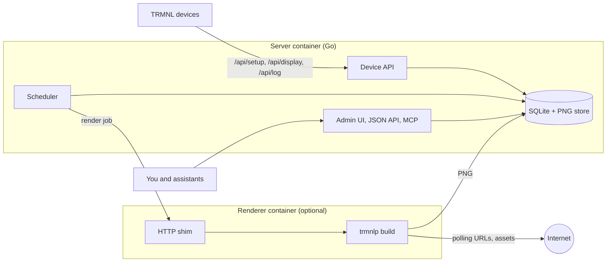

# TRMNL BYOS Server in Go: Design

## Summary

We will build a small Go + SQLite server that speaks the TRMNL device protocol, pre-renders every screen before the device wakes, and renders TRMNL recipes unmodified by driving trmnlp in an optional sidecar container. The first deployment is two 7.5" OG DIY kits on a Proxmox container, but nothing is hardcoded to that panel.

**Goals**

- Support every model in TRMNL's registry: 1-bit, 4-gray, 16-gray and the limited color palettes, at any size and scale factor.
- Run TRMNL recipes (settings.yml + Liquid + transforms) with the same output as TRMNL's own renderer.
- Keep the device awake as briefly as possible: one fast request per wake, no download or repaint when nothing changed.
- Small, boring operations: one static Go binary, one SQLite file, no database or queue server.
- Easy for an AI assistant to extend: recipes as the plugin format, an MCP server for authoring and previews.
- Safe firmware updates: never send a build to a board it was not built for.

**Non-goals for v1**

- Multi-user accounts. One admin, or auth delegated to a reverse proxy.
- A drag-and-drop screen designer.
- Proxying to the TRMNL cloud, OAuth plugins, and native (non-browser) rendering. These are designed for and deferred (see [Deferred work](#deferred-work)).

## Alternatives considered

No existing server combines faithful recipe rendering with a small footprint, so we build one and borrow their best ideas.

| Option | Stack | Why not | What we borrow |
| --- | --- | --- | --- |
| Terminus | Ruby/Hanami, Postgres, Valkey, Sidekiq, Chromium (4 containers) | Heaviest stack. Own Liquid with 15 of ~25 TRMNL filters, always uses the latest framework, no transforms. Playlist cursor is shared across devices and advances on every wake. | Per-device button command, sleep windows, extension refresh schedules, detailed device logs, model and firmware sync jobs |
| byos_next | Next.js, Postgres, optional Chrome | Last commit Jun 30. Own Satori-based screens looked weak. | Little |
| Inker | NestJS, SQLite, Chromium | Moving to an Inker-native ecosystem. Imitation TRMNL CSS (~300 lines). Sends 8-bit gray PNGs, so the OG shows black and white only. | Per-item durations with drift-free timing, clock-aligned wakes, shared data sources, encrypted plugin secrets, device blocklist, live UI events |
| LaraPaper | PHP/Laravel, SQLite, Chromium | PHP. Approximate Liquid by default, no transforms, user Blade templates run as PHP. | MCP server, time-limited join window, scheduled playlists, alias endpoint, staleness flags, cloud proxy (deferred) |
| Ogre (pure-Go HTML to PNG) | Go library | Bugs in basics (borders, SVG strokes, truncation, min-width), one maintainer, 13 outside PRs unreviewed. Cannot run the framework's JavaScript, so it can never render recipes. | Kept as a possible native renderer later |

**Why trmnlp.** trmnlp is TRMNL's own plugin development tool (MIT). It uses the official `trmnl-liquid` gem, the real page wrapper with pinned framework versions, runs transforms in Python, JS, Ruby and PHP, and copies TRMNL's quantization per palette. It is the closest open reference to how the cloud renders a recipe.

## Architecture

A Go server owns all state and answers devices from cached PNGs; an optional trmnlp container does the rendering, fed through shared volumes.

Device requests never wait on a render: the scheduler renders ahead, the shim runs one `trmnlp build` per job, and the PNG lands in the store by content hash.

- **Server**: device API, scheduler, store, admin UI, JSON API, MCP server and webhook ingest in one binary.
- **Renderer**: the `trmnl/trmnlp` image plus a small HTTP shim. It sees only the `projects` and `framework` volumes, never the database or secrets.
- **Framework mirror**: every framework release from TRMNL's public bucket, so recipes pinned to old versions keep rendering and fewer assets come from the internet at render time.

## Device protocol and profiles

The server implements the three endpoints TRMNL firmware calls, and never renders inside a device request.

| Endpoint | Request | Response |
| --- | --- | --- |
| `GET /api/setup` | `ID` (MAC), `Model`, `FW-Version`, `Width`, `Height` | `api_key`, `friendly_id`, a welcome `image_url`. Unknown MACs are accepted only while the join window is open. |
| `GET /api/display` | `Access-Token`, battery, RSSI, `Refresh-Rate`, `Update-Source`, `special_function`, `Wake-Time`, `Image-Cached`, `SENSORS`, `Width`/`Height` | `image_url`, `filename`, `refresh_rate` (a number), `special_function`, `update_firmware`/`firmware_url`, `reset_firmware`, `temperature_profile`, `maximum_compatibility` |
| `POST /api/log` | Firmware log entries | Stored per device with wake reason, heap and Wi-Fi state |

**Device profile.** Each device resolves to a profile: width, height, rotation, offsets, scale factor, palette, plus the framework's CSS parameters (CSS screen size, pixel ratio, dither pixel ratio, density class). Resolution order:

1. Per-device override set in the UI.
2. The firmware `Model` header mapped to a registry model. Firmware names differ from registry names (`xiao_epaper_display` and `og` map to `og_plus`; `x` maps to `v2`), so we keep a small mapping table.
3. `Width`/`Height` headers matched against the registry.
4. A conservative default (800x480, 1-bit).

The registry is a vendored copy of `trmnl.com/api/models` and `/api/palettes`, refreshed daily, never fetched per request.

**Non-TRMNL clients.** KOReader, Kindle, Kobo, Nook, Android and Raspberry Pi clients speak the same `/api/display`. They may omit firmware headers such as `Update-Source` or the battery fields, so every header is optional.

**Joining and leaving.**

- A time-limited join window (default 10 minutes) admits new MACs; otherwise unknown devices get a "not registered" response.
- A MAC blocklist rejects specific devices outright.
- Deleting a device makes its next request return `reset_firmware: true`, so it forgets its credentials.

## Scheduling and pre-rendering

Every screen a device might ask for is rendered before it wakes, and an unchanged screen costs the device one short request and no repaint.

**What the firmware gives us.** If `filename` matches a file in its flash cache, the firmware skips the download. If that image is already on the panel, it also skips the repaint (`displayed_image.h`). It reports the previous wake's duration in `Wake-Time`, which the dashboard plots.

**Rules.**

1. `filename` is a hash of the PNG bytes. Same pixels, same name.
2. `/api/display` is a SQLite lookup plus a static file. If nothing is ready (new device, cold start) it returns the last image, or a placeholder with a short `refresh_rate`.
3. `refresh_rate` is chosen from content, not fixed: the seconds until the current playlist item ends, the next aligned wake a plugin asked for (on the minute, on the hour), or the next sleep-window edge, whichever comes first.
4. Next wake = last request + the `refresh_rate` we sent. Renders are scheduled ahead of it with a lead time that covers render duration (seconds for trmnlp) plus deep-sleep clock drift.
5. Each device always has three screens ready: current (for button and power-on wakes), next (for skip and touch-bar next) and a short history (for rewind).

**Renders follow data, not wakes.** A plugin instance re-renders only when its `refresh_interval` comes due or its data changes. Wakes in between get the same filename. This matters because 8 of the top 25 recipes print the time or use randomness, so their output differs on every render.

**Render cache key.** (plugin instance, layout, device profile) by default. (plugin instance, layout, device) when the recipe references `trmnl.device.friendly_id` or battery fields. Two OGs showing the same weather share one render.

**Staleness.** Each instance records its last successful fetch. Past a configurable age the item is skipped in rotation, or shows a stale marker, instead of silently showing old data.

## Playlists, mashups and input

Rotation is time-based and tracked per device: each item shows for its own duration, and two devices on one playlist never steal each other's turns.

**Model.**

- A device has one or more playlists. Each playlist has an optional schedule: weekdays plus an active time window. The first active playlist in priority order wins; otherwise a default.
- A playlist item is either one plugin instance at full layout, or a mashup: a layout (left/right, top/bottom, quadrants) with a plugin instance per slot.
- Each item has a duration, or none. An item with no duration stays until a button or touch-bar press, with a long `refresh_rate`.
- Items can carry their own schedule (days, time window, date range) and a hidden flag.

**Cursor.** Stored per device as (current item, started at). When a wake finds the duration elapsed, the cursor moves to the next eligible item and the new start time is the old start plus the duration, so timing does not drift. A changed playlist sets a pending flag that resets the cursor on the next wake.

**Input.** The headers say what woke the device; we never guess from timing.

| Signal | Source | Action |
| --- | --- | --- |
| `Update-Source: timer` | Scheduled wake | Advance if the item's duration elapsed |
| `Update-Source: button` | OG single press | The device's configured command: next (default), previous, first, or refresh |
| `special_function` header | Double click, or the TRMNL X touch bar | `rewind` shows the previous screen from history, `restart_playlist` jumps to the first item; others as configured |
| Touch bar right | TRMNL X | Next |

The `special_function` value in our responses is a per-device setting, sent on every response as the docs require.

**Sleep window.** Per device, for example 23:00 to 06:30: show a sleep screen and set `refresh_rate` to the window's end.

**Mashups.** The framework renders a mashup as one page with mashup classes. v1 tiles separately rendered slot images as a fallback; rendering mashups as one page through trmnlp is an open question.

## Plugins and rendering

The plugin format is the TRMNL recipe, unmodified, and the renderer is trmnlp driven through a small shim; the Go server never parses Liquid.

**Recipe format.** A directory or the zip from `trmnl.com/api/plugin_settings/<id>/archive`: `settings.yml`, `full.liquid`, `half_horizontal.liquid`, `half_vertical.liquid`, `quadrant.liquid`, optional `shared.liquid` and `transform.{js,py,rb,php}`. Sources: the TRMNL gallery, the community catalog (`bnussbau/trmnl-recipe-catalog`), a git URL, or written locally and previewed with `trmnlp serve`.

**What the top 25 recipes need** (survey of trmnl.com by popularity):

| Need | Count | Handled by |
| --- | --- | --- |
| Polling strategy | 23 | trmnlp polls during `build` |
| `polling_url` is Liquid, sometimes several URLs (`IDX_0`, `IDX_1`) | 3 multi-URL, many templated | trmnlp |
| Transforms (4 JS, 1 Ruby, 1 Python) | 6 | trmnlp image ships Node, Python, Ruby, PHP |
| JavaScript in the page (3 load Highcharts) | 6 | Browser in the trmnlp image |
| Pinned framework version (7 distinct versions) | 24 | Framework mirror |
| `trmnl.device.*` in markup or URLs | 3 | Per-device project directory |
| Webhook strategy | 1 | Our webhook endpoint writes the data file |
| OAuth | 0 | Deferred |

**Render path.**

1. The server keeps a trmnlp project directory per plugin instance (per device when the recipe reads device fields): the recipe's `src/`, plus a `.trmnlp.yml` with custom field values, time zone, locale and the device's `trmnl` variables as overrides.
2. For webhook recipes, the server stores pushed data, applies the merge mode (`replace`, `deep_merge`, `stream`) and writes the result where trmnlp reads webhook data.
3. When a render is due, the server calls the shim, which runs `trmnlp build --png --width W --height H --palette P` in that directory and returns the PNG. One build at a time to start.
4. The server stores the PNG under its content hash and updates each affected device's ready screens.

**Settings.** Forms are generated from `custom_fields` (`select` incl. multi-select, `string`, `number`, `lat_lon`; `author_bio` is metadata only). Time zone and locale are server-wide with per-device overrides; instances carry name, dark mode, icon and an optional framework version pin.

**Renderer interface.** Rendering sits behind one interface (`Render(job) -> PNG`). v1 has the trmnlp backend and a static-image backend for system screens (welcome, sleep, error, not registered). An image-URL backend (fetch a PNG such as a Grafana panel, quantize in Go) and a native Ogre backend are deferred.

## Firmware updates

The server is the only thing preventing a wrong-board update, so it offers a firmware build only to devices whose exact firmware model it was built for, and only when asked to.

**Why it has to be the server.** The firmware's OTA path (`firmware_update.cpp`) is `esp_ota_begin` / `esp_ota_write` / `esp_ota_end` with no board check. ESP-IDF's image verification rejects a different chip family (C3 vs S3) but not a different board on the same chip, and app rollback is disabled in the TRMNL X config we checked. A TRMNL X build sent to a XIAO S3 kit would install, boot with the wrong pins, and might need USB to recover.

**Rules.**

1. Each catalog entry names exactly one firmware model (the `Model` header value, e.g. `xiao_epaper_display`), a version, and a SHA-256. No wildcards, no "latest" URL.
2. On upload, parse the ESP image header (chip ID) and the app description (version, IDF version). Reject the file if the chip does not match the model's known chip or the version string disagrees with the entry.
3. Offer an update only if the catalog version is newer than the device's `FW-Version`, the device has updates enabled, and the device is not pinned to its current version. Never downgrade.
4. Roll out to one device first. Offer to the others only after that device checks in reporting the new `FW-Version`.
5. Serve only the exact stored file; `firmware_url` points at our server with the hash in the path.

**Sources.** Builds you upload, or official releases synced from TRMNL on a schedule (as Terminus does), both going through the same checks. Taking `update_firmware`/`firmware_url` from the TRMNL cloud via the deferred cloud proxy is another option, since the cloud already picks per device.

## Data model

One SQLite file (WAL mode) holds all state; rendered PNGs and recipe sources live on disk next to it, addressed by hash.

| Table | Key fields |
| --- | --- |
| `device` | mac, api_key, friendly_id, name, fw_model, fw_version, profile_override, palette_override, time_zone, locale, button_command, special_function, sleep_start, sleep_end, updates_enabled, fw_pin, blocked |
| `device_state` | device_id, last_seen, last_refresh_rate_sent, battery_v, battery_pct, rssi, wake_time_ms, update_source, playlist_id, item_id, item_started_at, pending_reset |
| `device_log` | device_id, at, level, message, wake_reason, free_heap, max_alloc |
| `sensor_reading` | device_id, at, kind, value, unit (latest kept per kind, plus history) |
| `model` / `palette` | Vendored registry rows plus the framework CSS parameters |
| `recipe` | id, source (gallery, catalog, git, local), source_ref, source_hash, settings (parsed), approved_hosts |
| `plugin_instance` | recipe_id, name, field_values, secret_values (encrypted), framework_pin, dark_mode, refresh_override, align, stale_after |
| `instance_data` | instance_id, data (webhook payload), updated_at, last_error, last_success_at |
| `playlist` | name, schedule (weekdays, from, until), priority |
| `playlist_device` | playlist_id, device_id |
| `playlist_item` | playlist_id, position, kind (single or mashup), layout, duration_s, schedule, hidden |
| `playlist_slot` | item_id, slot, instance_id |
| `render` | key (instance, layout, profile or device), png_hash, rendered_at, data_hash, duration_ms, error |
| `device_screen` | device_id, role (current, next, history n), png_hash |
| `firmware` | fw_model, version, sha256, chip, idf_version, source, uploaded_at |
| `firmware_rollout` | firmware_id, canary_device_id, state |
| `setting` | key, value (join window, secrets key id, defaults) |

Migrations are embedded in the binary and run at startup.

## Admin UI, API and MCP

One JSON API backs the web UI, scripts and the MCP server, so anything you can click you can also script or ask an assistant to do.

**Web UI** (server-rendered HTML with small progressive enhancements, live updates over server-sent events):

- Dashboard: devices, last seen, battery and wake-time trends, current screen thumbnails.
- Devices: profile, playlist, button command, sleep window, firmware, logs, join window toggle.
- Recipes and instances: install from gallery, catalog, git or upload; settings form from `custom_fields`; rendered outbound hosts for approval; preview at any device profile.
- Playlists: items, durations, schedules, mashups.
- Firmware: catalog, upload, rollout state.

**JSON API** (`/api/v1`, bearer token): devices, recipes, instances, playlists, renders, firmware. Narrow on purpose; no attempt at parity with Terminus.

**Inbound data.**

- `POST /api/custom_plugins/<uuid>` accepts `merge_variables` with `merge_strategy` (`replace`, `deep_merge`, `stream`), compatible with TRMNL's webhook shape, with a rate limit.
- `POST /api/screen` accepts a full markup or PNG screen from a script.

**Alias endpoint.** `GET /api/alias/<uuid>?model=<name>` returns a plugin instance's current image for any model, for clients outside a playlist (a Home Assistant card, a web page).

**MCP server** (`/mcp` over HTTP, plus stdio), tools:

- `list_recipes`, `get_recipe`, `create_recipe`, `update_recipe` (markup, settings, transform)
- `render_preview` (instance, layout, model) returning the PNG
- `list_devices`, `get_device`, `list_playlists`, `update_playlist`
- `get_logs` (device, since)

This lets an assistant write a recipe, render it, look at the result and iterate against the real server.

## Security and privacy

The device API is LAN-only and token-based; the admin side needs a login; and recipes are treated as untrusted code that talks to the internet.

- **Admin auth.** One admin password (argon2id hash) with session cookies, or trust an identity header from a configured reverse proxy. API and MCP use bearer tokens created in the UI.
- **Device auth.** Per-device `api_key` from setup, compared in constant time. Device endpoints can listen on a separate port bound to the LAN.
- **Secrets at rest.** Custom fields marked secret (API keys, passwords) are encrypted in SQLite with a key from the environment; the UI never shows them back.
- **Outbound review.** On install, the server renders each recipe's polling URLs with the current settings and lists the hosts, plus image and script hosts found in its markup. You approve them. Example: Paperboy sends the device ID, battery level and a timestamp to a third-party "battery" endpoint.
- **Transforms and page JavaScript** run inside the trmnlp container, which has no access to the server's database or secrets volume and gets only its project directories. It is not a sandbox: an egress allowlist on that container is the stronger control (open question).
- **Plain HTTP on the LAN** saves the ESP32 a TLS handshake per request. HTTPS via a reverse proxy remains an option.

## Deployment and footprint

Two containers and three volumes; the server alone is small, and the renderer's size is the price of recipe fidelity.

| Component | Contents | Size | Required |
| --- | --- | --- | --- |
| Server | Static Go binary, embedded UI and migrations, system-screen fonts | ~20 to 30 MB (estimate) | Yes |
| Renderer | `trmnl/trmnlp` (Ruby, Firefox ESR, Node, Python, PHP, ImageMagick) + the shim | ~580 MB compressed (Docker Hub, v0.34.1) | Only for recipes |

**Volumes.**

- `data`: SQLite file, rendered PNGs, firmware files. Back up this one.
- `projects`: trmnlp project directories, shared with the renderer. Rebuildable from `data`.
- `framework`: mirror of every framework release from TRMNL's public bucket (`index.json` + per-version CSS/JS), plus fonts, pattern images, and cached Highcharts and icon assets. Shared with the renderer.

**Runtime.** Idle memory stays low if the shim starts `trmnlp build` per render, since Firefox exists only during a render. Peak memory and render time are not measured yet.

**Proxmox.** An LXC with Docker, or a small VM, works. Compose file and a single env file ship with the repo. Updates are `docker compose pull`; schema migrations run at startup.

## Deferred work

Each of these has a place in the design so it can land later without reshaping the data model or the device API.

| Feature | Where it plugs in | Notes |
| --- | --- | --- |
| Native rendering (Ogre or SVG + resvg) | Renderer interface, new backend | For our own small plugins; never for recipes, which need the framework's JavaScript. Ogre needs upstream fixes first. |
| Image-URL plugins (Grafana panels, camera snapshots, radar) | Renderer interface, Go quantizer | No browser needed. Likely the first native backend. |
| TRMNL cloud proxy (hybrid) | A screen source per device | Needs TRMNL Developer edition. Gives native cloud plugins and model-correct firmware offers. |
| OAuth plugins | Plugin instance fields `oauth_*` | trmnlp has OAuth helpers; the server needs a callback flow. |
| Async polling and Plugin Merge strategies | `instance_data` | Async: answer 202, accept a callback. Merge: one instance reads another's data. |
| Multi-user accounts | `user` table, ownership columns | Keep the single-admin path as the default. |
| Firmware hosting from TRMNL releases | `firmware` sync job | Same validation as uploads. |
| Server-side sensors | `sensor_reading` with source = server | Device sensors via the `SENSORS` header are in v1. |

## Open questions and risks

The biggest risk is coupling to trmnlp, a 0.x development tool whose CLI and directory layout are its only interface.

- [ ] How long does `trmnlp build --png` take per render, and what is its peak memory? Measure on the Proxmox host.
- [ ] Can trmnlp render a mashup of several recipes as one page? If not, is tiling slot images good enough, or do we generate the mashup page ourselves?
- [ ] Does writing webhook data into the project's data file work the way `user_data_assembler.rb` suggests?
- [ ] Do concurrent `trmnlp build` runs in different directories interfere? Start with one at a time.
- [ ] Can trmnlp's asset overrides point every framework, Highcharts and icon URL at the local mirror, so recipes render offline?
- [ ] Does the firmware accept a plain `http://` server URL? Confirm in code and on a device.
- [ ] Which firmware `Model` values map to which registry models? Build the table from `platformio.ini` and `config.h`.
- [ ] Should the trmnlp container get an egress allowlist built from approved hosts?
- [ ] Admin auth: built-in password login, reverse-proxy identity header, or both?

**Risks.**

- trmnlp CLI or layout changes break rendering. Mitigation: pin the image, golden-image tests over the community catalog, upgrade deliberately.
- Framework 4.0 removes 3.x classes. Recipes pinned to 3.x are fine with the mirror; recipes on `latest` may break. Mitigation: show the resolved version and allow pinning per instance.
- TRMNL changes the device protocol. Mitigation: the protocol surface is small and covered by tests built from real firmware request captures.
